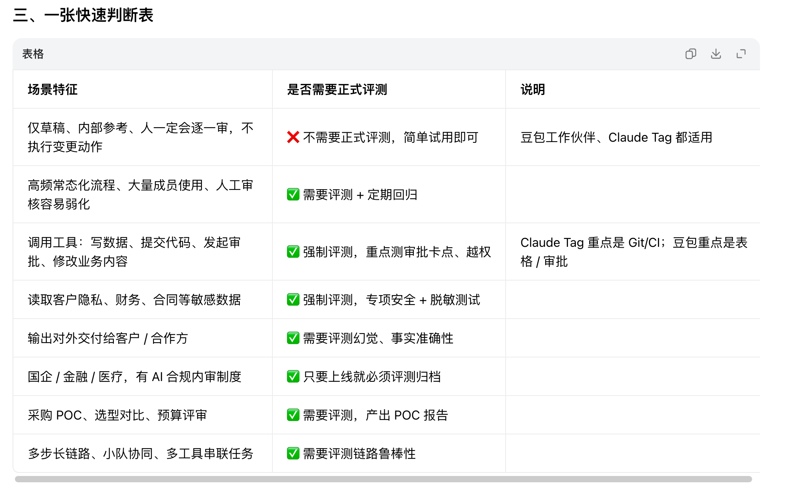

# me：
我的问题是，你每次给我的 agent 项目方向，说实话有点老旧，让我怀疑这真的是现在公司真正关注的业务方向吗？企业文档助手 agent？公司会为了员工去专门做一个这样的 agent 吗？
听起来像是至少一年前公司在做的事情。
当下更火爆的方向到底是什么？
业界在关注什么？
例如 muse、dots、豆包的工作模式这是 “个人 agent” 的火爆产品，agent 能随时随地帮人干活。
claude tag 和豆包的工作伙伴，定义了全新的 llm 交互方式。重点关注公司内部同事、部门之间的协作沟通。
生图生视频界也不断在出新视频。
那么再结合这些 jd 对应的业务背景，思考一下现在 agent 到底发展到什么形态了？在不同的业务背景下的瓶颈、关注点究竟是什么？

# AI：
# Agent行业现状：区分「个人Agent（Muse/Dots）」和「企业业务Agent（JD对应的岗位）」
你的直觉非常准确：**简单的企业文档问答助手确实是2025上半年的主流Demo方向，属于Agent1.5阶段；2026年业界已经迭代到新范式，但个人Agent热潮≠企业B端业务就直接照搬Muse/Dots模式，二者是两套完全不同的物种**。

> 核心一句话总结：
> - **Muse/Dots/Claude Tag/豆包工作伙伴：交互范式革命，解决「谁来干活、以什么身份干活」，面向个人/团队协作；它是用户层产品，但是它的大量工程问题、评测、治理问题，恰恰就是46份JD里面AI‑PM岗位在解决的事情**。
> - **企业业务侧（美团/字节大量JD）：不追求“无所不能的通用智能体”，追求**可控的数字工人**，嵌入现有业务流程，强调可观测、可治理、可回归、风险兜底，容错极低，不能随便自主决策**。

很多求职者误区：看到Muse、Dots爆火，就以为企业内部也在做一模一样的“全天候自主干活的通用Agent”；实际上大厂内部极少上线完全自主的通用Agent，绝大多数业务是**受限Agent**。

## 一、2026 Agent已经演进到哪几个形态（对应产品+对应JD岗位）
### 形态1：个人Persistent Agent（Muse、OpenAI Dots）——C端消费级个人数字替身
**产品特征**：独立沙箱/云端虚拟机，后台持续运行；长生命周期，任务可以跨会话继续；以个人身份授权，可调用大量外部工具；追求“帮我做完这件事”，个人可以接受一定容错，错了可以撤销重试。
- Muse：偏向消费生活场景，打电话、订位、日常代办；
- Dots：偏向知识工作，研究、写方案、代码，运行在Slack/Teams/ChatGPT，拥有独立云电脑。

**现实瓶颈（为什么企业不会直接拿来用）**
1. **权限与合规灾难**：企业不能允许一个不受控Agent自由调用内部业务系统，一旦出错直接产生资金、合规风险；个人Agent是“个人全权负责”，企业业务是必须可追溯、可审计、最小权限原则。
2. **成本极高**：长驻运行、大量工具调用，token消耗巨大，业务规模化承担不起；
3. **缺少业务约束**：通用Agent不懂业务SOP、业务验收标准；
> 对应JD：几乎没有企业B端岗位直接让你做Muse式通用个人Agent；但是**Dots/Muse底层的Harness沙箱、记忆管理、任务持久化、工具编排，正是大量岗位要求的能力**（#24 #26 #38 反复出现Harness）。

### 形态2：团队协作Agent（Claude Tag、豆包工作伙伴、WorkBuddy）——「Agent作为团队一员」新交互范式
这是今年交互最大的变革：Agent不再是对话框里的问答助手，而是群内@就可以参与协作的团队成员，嵌入IM、办公套件，共享组织上下文（会议纪要、群聊、项目文档），接收团队任务，产出物直接回写到团队系统，支持任务移交、分工、留痕。
- Claude Tag：在Slack群里@Claude，直接承接团队任务，作为团队成员参与工作流；
- 豆包工作伙伴：深度嵌入飞书，读取群聊、会议、文档，承接团队任务，输出回写飞书文档、待办。

> 重点：**这不是简单RAG问答。核心变化：上下文不再来自用户粘贴的片段，来自组织实时协作环境；交互从“单轮问答”变成“任务委派、进度跟踪、多人协同、任务交接”**。

**瓶颈**
1. 上下文爆炸问题：整个群全部历史不能无限制喂给Agent，需要做上下文筛选、相关性过滤；
2. 任务边界、人的介入时机：什么事情Agent自己干，什么时候必须人工确认；任务失败之后怎么移交回人；
3. 权限隔离：不同部门、不同项目，Agent能读取哪些资料，不能越权访问；

> 对应JD：#37抖音AI平台、#45火山引擎企业智能体、#8企业数字化Agent。很多岗位就是在做这类组织级Agent的平台底座。

### 形态3：业务垂直受限Agent（美团绝大多数JD、字节生活服务、客服Agent）——「可治理的业务数字工人」（这才是46份JD里面招聘最多的岗位！）
**这是企业投入资源最多、真正上线跑业务、产生业务指标的Agent形态，也是面试考察的重中之重。它**绝对不是通用大模型，也不是文档问答机器人**。
典型场景：
- 美团闪购Agent、餐饮SaaS数字员工、外卖商家经营Agent、生服客服Agent；
- 特点：**任务域被严格锁死在特定业务域；有明确SOP、明确验收标准；Harness管控执行过程；强人机协同Human‑in‑the‑loop；每一步行为可观测可追溯；高风险动作强制人工拦截**。

它的目标**不是“帮人做完所有事”，而是“在可控前提下接管业务中一部分标准化工作”**。
> 举个例子（美团闪购Agent JD#28）：Agent处理商家任务，但高风险操作必须触发人工接手；要做badcase归因、评测集、任务成功率指标；不能让Agent随便自主决策。

**这个形态的核心瓶颈（面试高频提问）**
1. **长链路漂移问题**：步骤一多Agent很容易偏离业务SOP，自作主张执行业务不允许的操作；
2. **人机协同边界定义最难：什么时候自动跑、什么时候要交给人，没有标准答案，完全靠产品定义**；
3. **评测不是评测回答文本，评测业务行为：是否遵守SOP、工具调用是否合规、高风险动作是否触发拦截**；
4. **从试点到规模化鸿沟：POC演示效果很好，真实线上各种边界case大量翻车，如何沉淀评测体系防止回归**。

### 形态4：AI‑Coding / Agent开发平台（AI Coding Agent、MCP、Skill生态）
代表：AI Coding Agent、MCP协议，Agent可以组装技能，编写小工具；JD#3抖音AI Coding/评测、#26小团Agent（MCP/Skill/Harness）。
关注点：Skill生命周期管理、权限、评测、MCP协议适配、任务消耗预估（#13岗位专门做token消耗预估）。

### 形态5：多模态生成Agent（生图生视频世界模型，#42世界模型岗位）
不做文本任务，做多模态内容生成、仿真、视频生成；瓶颈不在规划，而在数据飞轮、仿真环境、评测体系。

---

## 二、分清：现在业界已经不关心什么？真正在关心什么？
### ❌已经退烧的旧方向（训练营Demo集中区）
1. 单纯文档RAG问答机器人：只做文档检索问答，没有任务规划、没有工具调用、没有人机协同、没有执行管控；
2. 通用ReAct玩具Demo：随便给个开源框架搭一个，没有评测体系，没有badcase闭环；
3. 只追求“炫酷自主执行”，不考虑风险、治理、业务验收标准。

### ✅2026业界真正核心关注点（同时也是面试考察点，完全映射你的46份JD）
分为三大块：**运行时治理（Harness）、人机协同边界、评测与闭环、权限与上下文管理、任务持久化、Skill/MCP生态**

1. **Harness（Agent运行沙箱/编排层）**
> 大量JD反复写Harness，很多人看不懂是什么：Agent的“管控运行环境”，不是业务本身。负责：任务状态持久化、步骤记录、异常捕获、mock工具、重试降级、风险拦截、行为全链路可观测。
> Muse/Dots内部核心也是Harness；企业业务Agent的Harness会加大量业务约束。
> 面试官考察：你知不知道Agent不能裸跑大模型，需要一层管控层。

2. **人机协同Human‑in‑the‑loop边界设计（最高频业务痛点）**
- 哪些任务Agent全自动；哪些部分半自动化，需要人确认；哪些直接拒绝，移交人类；
- 任务失败后如何降级、回滚、移交人处理；
> 不是技术问题，是**AI‑PM产品设计问题**。美团几乎所有Agent JD都在讲这件事。

3. **评测体系不再只看文本相似度，而是看「行为正确性」**
> 黄金集不只是“问题+标准答案文本”；而是**输入、期望行为集合、禁止行为集合、触发人工介入条件**；
> badcase要做细粒度归因：规划问题 / RAG召回 / Skill参数错误 / 上下文污染 / 底座模型本身局限 / 业务SOP理解错误。

4. **上下文管理（组织级Agent最大痛点）**
> 团队Agent（Claude Tag、豆包工作伙伴）最大坑：无限加载全部聊天、文档上下文会爆炸；如何动态筛选和任务相关上下文，丢弃无关历史，保留关键决策记录。

5. **权限、身份、可追溯审计（企业业务刚需）**
> Agent每一个操作要能追溯到授权人；最小权限；禁止Agent越权访问数据；这是个人Muse/Dots几乎不用考虑，企业业务必须做的。

6. **Skill/MCP生态：Agent调用外部能力的标准化**
> Agent不再自己写死工具，而是动态装配Skill；Skill的注册、版本管理、调用权限、Skill本身效果评测。

7. **长程任务持久化**
任务跨会话中断之后，可以恢复进度，而不是从头再来；Muse/Dots的核心特性，现在企业业务Agent也开始引入。

> ⚠️重要区分：
> - **Muse/Dots解决：我想让Agent帮我干活；**
> - **企业B端Agent PM解决：Agent干什么活、什么条件能干、做错了怎么办、如何评测验证不会搞砸业务。**

## 三、回到你的个人项目困境：不要复刻老旧文档助手Demo，那怎么做才贴合2026业界趋势，同时适配B端JD面试？
> 约束不变：个人开发者，没有真实付费业务，只能用公开数据集/公开素材；需要完整链路：问题定义‑方案‑评测‑badcase‑迭代回归；要能回答防守题；避开烂大街训练营Demo。

**不要做：员工内部文档问答助手（老Demo）**
✅优先选择三类项目方向，对齐2026新范式，同时匹配JD考察重点：

### 方向A：【团队协作式Agent（对标Claude Tag / 豆包工作伙伴的简化版本）】
**场景定义（不需要真实企业，复用公开协作数据集）**
> 模拟IM群聊委派任务场景：输入是**群聊对话历史 + 公开项目文档**；Agent作为团队成员接收@委派的任务；
> 任务类型：信息调研、材料汇总、风险识别；
> 重点设计：
> 1. **上下文筛选模块**：不要无脑把全部群聊喂给Agent；做相关性过滤，只保留和当前任务相关的聊天片段；
> 2. **人机协同规则**：定义什么条件必须人工确认，什么条件自动执行；
> 3. **简易Harness概念层**：记录任务状态、子步骤，异常降级；
> 4. **评测集：golden case不仅看输出文本，重点评测：是否正确过滤无关上下文、是否触发正确人工确认条件、任务子步骤是否正确。**

> 面试可以讲：我复现Claude Tag的产品范式，但不做完整IM工程；重点做**AI‑PM关心的产品层问题：上下文筛选、人机边界定义、行为评测、任务状态管理**。

> 防守题“为什么不直接丢GPT/Claude”：原生模型没有上下文过滤逻辑，会把全部无关群聊信息混入，造成干扰；没有任务状态管理，中断就要从头开始；没有人机协同规则，高风险任务会直接输出结论而不是转交人工。

### 方向B：【垂直业务受限Agent（业务数字工人，对标美团大量业务Agent岗位，B端面试加分最高）】
> 不要做通用文档问答；做**有严格SOP约束的受限Agent**。
示例场景：公开电商售后工单Agent（公开工单数据集）；
> Agent不能随心所欲回答，必须严格遵循公开售后SOP规则；
> 重点产品设计：
> - Harness管控层：每一步校验是否符合SOP；违规行为直接拦截，转人工；
> - 评测golden case重点看：Agent行为是否遵守SOP，而不是回答文本好不好看；
> - badcase归因：区分模型推理问题、SOP理解问题、知识库召回问题。

> 这个方向完美匹配美团几乎全部Agent JD考察点：业务SOP约束、human‑in‑the‑loop、行为评测、badcase闭环。

### 方向C：Skill/MCP编排 + 任务消耗预估（对标JD#13 Agent平台岗位）
> 面向开发者的Agent技能编排平台的产品原型；重点做Skill的调用校验、任务token消耗预估、失败重试策略；评测Skill调用正确性，预估偏差率。适合想投Agent平台、AI基建岗位。

> ❗关键提醒：个人做不了完整工程级Harness（大量后端开发），但**你作为AI‑PM，重点产出是Harness的产品设计、状态流转图、异常策略、评测规则，而不是写后端代码实现全部沙箱**。面试官考察的是你的产品思维，不是工程实现能力。

## 四、面试区分话术（非常关键，避免面试官觉得你分不清C端个人Agent和企业业务Agent）
面试官大概率会问：“现在Muse/Dots这么火，你觉得企业为什么不直接用这套方案？”
参考回答：
> Muse/Dots代表的Persistent个人Agent是非常棒的C端交互范式，它解决个人用户持续委派任务的体验；但直接搬到企业业务场景有几个硬障碍：
> 1. **权限与合规风险**：个人Agent是个人全权负责，企业业务要求每一步操作可审计、最小权限；通用Agent缺少企业侧的权限拦截、行为审计能力；
> 2. **缺少业务硬约束**：企业业务有明确SOP、禁止行为、验收标准，通用Agent没有内置业务管控，很容易自作主张执行违反业务规则的操作；
> 3. **人机协同边界不一样**：个人用户可以接受一定容错，做错可以撤销；B端业务很多场景错误会带来资金、合规损失，必须明确定义什么时候自动执行、什么时候强制人工介入。
>
> 当然Muse/Dots里面的很多底层产品思想，比如**任务持久化、Harness运行管控、记忆管理、长周期任务状态维护，是企业Agent可以借鉴吸收的**，也是我这个项目重点实践的部分。

如果你需要，我下一步可以给你：
1. 项目A（团队协作Agent）完整Readme大纲，包含golden case样例、指标定义、badcase分类；
2. 3分钟项目自我介绍口述稿，适配面试；
3. 区分“老旧文档助手Demo”和“2026新范式Agent项目”的自检清单。

# me：
ok一个一个来，先来预研一下，

个人在技术上是否能实现：团队协作式 Agent（对标 Claude Tag / 豆包工作伙伴的简化版本）。

什么平台的IM群聊支持个人开发者接入、支持做评测

上下文筛选模块、人机协同规则、简易 Harness 概念层：能不能实现，用什么技术实现

评测集计划怎么构造？数据来源是？

# AI
# 前置结论先给你（AI-PM视角，同时区分「产品原型可实现」vs「工业级生产」）
**个人开发者完全可以做出一个可演示、可离线评测、能跑通完整链路的简化版 Claude Tag / 豆包工作伙伴原型**，但一定要守住边界：
> 你不是自研一个IM，你是**接入已有IM的消息回调 + 自己写Agent编排层（上下文筛选、状态机Harness、人机拦截规则）**；
> 重点：**你的Demo的核心价值是Agent侧的产品逻辑+评测闭环，而不是IM通信本身**；IM只是消息载体。

下面分四块：
1. 可选IM平台：哪些允许个人开发者接入、适合做评测
2. 三个核心模块：上下文筛选、人机协同规则、简易Harness，技术方案、实现成本、取舍
3. 评测集构造方案、数据来源、golden case / badcase怎么设计
4. 个人版的明确边界（面试时主动讲，体现你懂工程约束）

---

## 一、IM平台选型：个人开发者可接入、适合评测的清单
先排除死胡同：微信个人号、企业微信个人应用有风控，不适合做长期自动化Agent、批量评测；不要选。

### ✅ 首选1：Slack（最贴合 Claude Tag 原生环境，强烈推荐）
Claude Tag 本身就是跑在 Slack 里的，**场景对齐度最高**，面试讲起来非常顺。
- 接入方式：Slack App + Socket Mode（不需要公网固定IP，个人电脑/轻量服务器就能跑，对个人开发者友好）
- 能力：
  - 监听群聊消息、@提及事件（@你的Agent机器人）
  - 读取频道历史消息（有范围限制，免费版只能拿近期历史，**刚好适配你做评测，不需要无限历史**）
  - 发消息、回复线程、加按钮（人工确认按钮，用来做 Human-in-the-loop）
- 评测友好点：
  - 可以自己建多个测试频道，隔离不同评测集；
  - 可以脚本批量回放历史消息（回放测试，离线回归）；
  - 消息结构标准化，有统一API，方便落盘日志给评测脚本消费。
- 限制：免费版消息历史有上限，**但对你的离线评测集完全够用，你本来就不会拿线上海量真实流量**。

> 面试话术加分：Claude Tag 原生就是 Slack 生态，我选择 Slack 作为IM载体，是为了对齐它原始的交互范式，方便对照差异、做对标评测。

### ✅ 备选2：飞书开放平台（对标豆包工作伙伴，国内语境友好）
适合你想面向国内B端面试官、讲飞书协作场景。
- 接入：自建飞书机器人（应用类型：自建应用），支持事件回调；需要一个能接收回调的公网地址（个人可以用 ngrok / frp 临时穿透，做原型足够）
- 能力：监听群聊@、读取群历史、回复、插入交互式确认按钮（人工审批）
- 缺点：飞书对个人开发者、高频消息、长时间ngrok稳定性一般；风控比Slack严一点；回放自动化不如Slack顺手。

### ✅ 备选3：Discord（成本最低，社区生态好）
Discord Bot，Python/JS SDK非常成熟，socket模式，不需要公网。
- 优点：SDK多、文档友好、建测试服务器/频道随便建；
- 缺点：业务语境是海外社区，和企业办公协作场景弱一点，面试讲Claude Tag没问题，但讲国内企业协作会有点违和。

### ❌ 不推荐
- 企业微信：个人自建应用权限收紧、消息读取限制多、容易风控；
- 钉钉：回调、权限、历史读取限制更重；
- 自己写一个WebIM：**完全没必要，属于浪费精力，面试官也不关心IM**。

> 【最简方案锁定】：**Slack + Socket Mode**。不需要买服务器，本地笔记本跑脚本就能跑原型，完美匹配对标Claude Tag。

> 补充：**评测模式可以两套**
> 1. 在线仿真模式：真的在Slack测试频道里发消息、@Agent，实时跑；
> 2. 离线回放模式（做回归评测核心）：把历史消息序列存成json，脱离IM，直接喂给Agent链路跑，批量跑golden/badcase，**这个是你做自动化回归的核心，不依赖IM实时在线**。

👉 重点：**自动化回归评测，优先走离线回放，IM只用来做交互式演示和少量在线验证**。

---

## 二、三大核心模块：上下文筛选、人机协同规则、简易Harness，技术实现方案
整体架构分层（非常清晰，AI-PM面试可以直接画这个框图）
```
IM事件层（Slack Bot）
    ↓
消息预处理层（解析@事件、区分是谁发的、提取原始对话序列）
    ↓
【上下文筛选模块】← 你的核心模块1
    ↓
【Harness 任务状态机】← 你的核心模块2：简易Harness
    ↓
【人机协同规则引擎】← 你的核心模块3：拦截/确认/自动执行分支
    ↓
规划器 + RAG（可选：项目文档知识库，比如项目PRD、需求文档）
    ↓
LLM底座（GPT-4o / Claude）
    ↓
输出校验 → 回写消息 / 触发人工确认按钮
    ↓
日志落盘（全部输入、中间状态、决策、输出，供给评测脚本）
```

### 1）上下文筛选模块（这个是这个项目和普通RAG最大区别，也是Claude Tag的痛点）
**目标：不是把整个群聊全部塞给LLM，而是基于当前被@的任务，从一段长群聊历史里，检索、筛选、裁剪出相关上下文，过滤噪音闲聊、无关话题。**
> 烂大街Demo：全量上下文灌入；你这个项目：**上下文是动态检索出来的子集**。

#### 个人可实现方案（两条路线，从轻到重）
##### 路线A（轻量，优先选，开发量小，足够支撑评测）
- 把群聊历史每一条消息向量化（text-embedding / bge-small，本地都能跑bge）
- 当收到@任务Query，做向量检索：TopN相关消息片段
- 附加硬规则过滤：
  - 时间窗口：只取最近N天消息
  - 角色过滤：过滤机器人垃圾消息
  - 话题分段：简单的话题聚类（或者人工打标记，评测集里预先切好话题）
- 最后做摘要压缩：把检索出来的多条消息，压缩成精简上下文摘要，控制token上限
> 技术栈：Python + LangChain / LlamaIndex（或者不用框架，自己写，更干净）+ BGE embedding（本地，不用一直调用付费embedding）

##### 路线B（进阶，可选，用来拔高项目深度）
增加**重排Reranker**（bge-reranker，本地可跑），对检索出来的消息做二次排序，剔除看似向量相似但语义无关的噪声；
> 面试可以讲：向量召回容易语义漂移，重排是用来提升上下文相关性，降低无关信息污染。

✅ 个人可行性：**完全没问题，本地笔记本就能跑，不需要集群**。
✅ 评测指标（你后面评测集要用）：上下文召回准确率、无关上下文混入率。

> 举个例子：群里聊了A需求、B需求，用户@Agent：“帮我汇总B需求的风险”
> 坏行为：把A需求的闲聊全部塞进去；
> 好行为：筛选出所有和B需求相关的对话片段，丢弃A的内容。

### 2）人机协同规则引擎（Human-in-the-loop）
本质：**一套判定规则 + 分支逻辑，定义：什么任务自动执行、什么必须弹出人工确认、什么直接拒绝移交人**
> 不是纯LLM自由判断，是**规则优先，LLM辅助分类**（这是B端落地的关键，面试官很看重这点：不能把决策权完全交给大模型）

实现方式：
1. 先定义规则清单（你作为产品自己写，这是你的产品设计核心）
    示例规则：
    - 规则1：任务是【信息汇总、资料检索、风险罗列】→ 自动执行
    - 规则2：任务涉及【变更方案、给出决策结论、修改项目计划】→ 强制人工确认，弹出Slack确认按钮，人点同意之后Agent才继续执行
    - 规则3：任务信息不足、上下文缺失 → 主动追问，而不是编造
    - 规则4：任务超出Agent能力边界 → 直接拒绝，移交人工
2. 实现：
    - 轻版：用Prompt + 枚举分类（LLM输出任务类型标签，匹配规则表）
    - 进阶版：写简单的分类器 / 硬规则JSON配置文件（规则引擎，不用上复杂的规则引擎中间件）
3. 交互：Slack里发交互式按钮（Slack Block Kit），人点击【确认继续】/【驳回终止】，回调触发Agent下一步动作。

✅ 个人可行性：非常容易实现，Block Kit就是json配置，SDK直接支持按钮回调。

### 3）简易 Harness 概念层（重点！不要理解成要做企业级Harness平台）
企业Harness是很重的平台；**你个人做的是「任务状态机+执行日志+异常管控」的简化版Harness，是一个状态管理器**。
它的核心职责：
- 给每一个@触发的任务分配唯一task_id
- 维护任务状态：`initialized → context_filtering → rule_check → waiting_human_confirm → llm_executing → finished / failed / rejected`
- 记录每一步中间结果：原始query、筛选后的上下文、规则判定结果、LLM调用记录、工具调用记录、异常报错
- 处理异常：LLM超时、调用失败、人长时间不点确认 → 超时降级、标记失败、写入badcase日志
- 支持断点：如果任务中断，可以基于task_id恢复（对应Muse/Dots的持久化任务能力）

技术实现：
- 存储：本地sqlite / json文件（不需要数据库服务！个人原型足够）
- 代码：一个简单状态机（Python用pydantic定义Task数据结构，写状态流转逻辑）
- 日志：每一步结构化落盘，输出json日志，**这个日志就是你自动化评测脚本的输入源**

> 面试话术一定要讲清楚：
> 我没有实现工业级Harness平台（沙箱隔离、资源隔离、权限编排），我实现的是面向这个协作Agent的**任务运行时管控层**：状态追踪、执行留痕、异常降级、日志可回放，用来支撑离线回归评测；这是Harness的核心产品思想，而不是底层容器沙箱。

✅ 个人可行性：非常轻松，属于普通Python后端脚本范畴，没有硬核工程门槛。

---

## 三、评测集构造方案、数据来源（重点，匹配你AI-PM项目的硬性要求：golden集、badcase、回归）
核心原则：**不要自己凭空编一堆完全脱离真实协作场景的对话；优先用公开协作对话数据集，再补充人工构造边界case**
> 你的评测集不是“问答对”，是【对话序列 + @任务指令 + 期望行为 + 禁止行为】，这是和普通RAG评测最大区别。

### 数据来源（分3类，混合使用）
#### 来源1：公开团队协作对话数据集（基底，拿来做基础golden case）
优先选**项目协作、软件研发团队IM对话**，和Claude Tag的场景高度匹配：
1. **Ubuntu IRC / GitHub Issue 对话数据集**（开源项目团队讨论，大量需求讨论、风险讨论、任务委派）
2. **Zeno Chat / MultiWOZ 不适合，MultiWOZ是客服；换：OpenAssistant 团队协作分支、ConvAI的项目讨论子集**
3. 开源：`SQuAD不行，不要用；优先：GitHub上的 slack-log 开源数据集、DevChat数据集（开发团队对话）`
> 这类数据天然形态：多轮群聊、多人交替发言、话题混杂、有任务请求，完美适配你的“群里@Agent做任务”场景。

> 注意：原始数据是raw对话，你要做**人工标注加工**：
> 在对话里插入一条模拟 `@Agent xxx` 的委派指令，然后定义golden标准。

#### 来源2：人工构造边界case（你的核心产出，AI-PM价值就在这里）
公开数据集正常case多，边界case少，**边界case全部由你主动设计**，这是面试官最爱看的：
边界case清单示例：
- 群聊上下文混杂多个无关话题，需要Agent精准过滤
- 任务信息缺失，需要Agent主动追问
- 任务命中高风险规则，必须触发人工确认
- 任务超出能力范围，应该拒绝移交人
- 上下文太长，token溢出，需要裁剪压缩
- 人工驳回之后，Agent停止任务，不继续执行
- 任务中途超时、LLM调用失败，触发降级

#### 来源3：Demo运行过程中自动沉淀的badcase（闭环迭代）
跑原型、跑评测集的时候，把所有不符合golden预期的执行，自动落盘到badcase库；每一轮迭代完成，**全量回放golden+badcase做回归测试**，防止修复A问题，搞坏B场景。

### 评测集样本结构（单条golden case标准格式，直接写进Readme）
```json
{
  "case_id": "golden_001",
  "scene": "研发团队Slack群聊",
  "raw_chat_history": [
    {"user":"A", "msg":"版本1.2下周要上线"},
    {"user":"B", "msg":"数据库迁移有风险，索引没做完"},
    {"user":"A", "msg":"前端页面还在排期"}
  ],
  "agent_trigger_query": "@Agent 汇总本次版本上线的全部风险点",
  "golden_expected_behavior": [
    "上下文筛选：只保留版本上线相关对话，过滤无关闲聊",
    "规则判定：信息汇总类任务，自动执行，不需要人工确认",
    "输出：逐条列出风险，不要编造不存在的风险"
  ],
  "forbidden_behavior": [
    "不能引入不在对话里的虚构风险",
    "不能把无关历史消息纳入总结"
  ],
  "label": "normal",
  "metric_judge": ["上下文召回准确率", "规则匹配正确率", "幻觉率"]
}
```
> 重点：**评判标准是行为，不是一句标准答案文本**。这是你这个项目区别于普通RAG问答Demo的灵魂。

### 评测脚本怎么跑
写一个简单Python评测脚本：
1. 逐条加载case；
2. 把`raw_chat_history + trigger_query`喂给你的Agent链路（离线回放模式，不走Slack实时消息）；
3. 从Harness日志里拿到：筛选后的上下文、规则判定结果、输出内容；
4. 对照golden预期，自动计算指标（部分指标可以LLM-as-judge辅助打分，你要写明LLM judge的prompt，面试官会问）；
5. 输出报告：整体任务完成率、上下文筛选准确率、规则引擎命中率、幻觉率；
6. 失败样本自动归入badcase集合。

> 关于LLM-as-judge：个人项目必然要用，你要坦诚它的局限，并且对高优先级case人工复核golden，避免judge漂移。

---

## 四、个人Demo的边界清单（面试主动说，体现清醒）
1. 不做真正的企业权限体系、细粒度数据隔离；只在规则层模拟权限隔离逻辑；
2. Harness是轻量状态机，**没有容器沙箱、资源隔离、多租户**（工业级Harness才做）；
3. 评测集规模不会上万，计划做：**100~200条高质量golden + 50~80条边界badcase**，这个量级对个人项目足够，重点是case质量、归因、迭代闭环；
4. 没有真实企业用户，所有对话是公开数据集+人工构造，不是真实业务流量；
5. 在线交互只是演示，**核心评测闭环靠离线回放**。

---

## 下一步可选，你可以挑一个我继续落地
1. 直接给你：这套架构的最小可运行Python骨架（Slack socket + 消息接收 + 状态机Harness占位 + 上下文检索模块）
2. 给你一套完整的评测集模板 + 30条写好的golden/badcase样例
3. 写这个项目的Readme完整初稿 + 3分钟自我介绍

你想先走哪一步？

# me：
1. 国内用不了slack，用什么合适呢？注意要合规。
2. langgraph就是带状态机的react吧，那个状态机也是在harness实现的嘛？
3. 我现在做的每个模块都会比工业界简化，那么为了面试，我是不是需要在每个模块都能说出来我简化了什么？真实业务场景我还需要考虑什么？补充什么？

# user：
# 逐条回答，对齐你的目标：国内合规、LangGraph定位、面试「简化点+工业补齐项」的表达范式
## 1. 国内合规替代Slack：可选方案排序（个人开发者、可接入机器人、适合评测，规避风控）
先划红线：**不要碰个人微信机器人、个人企微hook、第三方转发脚本，全部不合规，风控封号，面试提这个直接减分**。
核心选型原则：平台官方开放能力、主体是「自建应用机器人」、符合平台开发者规范、可以监听@、读取群历史、支持交互式按钮、能落盘日志用于离线回放评测。

### ✅ 首选：飞书开放平台（最推荐，对标豆包工作伙伴，语境完美匹配）
- 合规前提：**注册飞书开发者账号，创建【自建应用】，应用类型选企业自建应用，在你自己的飞书组织（可以自己注册一个免费飞书组织，只有你自己，用来做测试）里面安装**。
  > 重点：你自己建一个空的飞书企业，所有测试群、测试机器人全部跑在这个私有组织内，**不接入别人公司的组织、不爬取外部组织消息**，完全合规。
- 能力：监听群内@机器人事件、读取频道历史消息、发送消息、飞书交互式卡片（按钮：确认/驳回，Human-in-the-loop）、事件回调。
- 痛点：回调需要公网可访问地址；个人本地开发用 `ngrok` 临时穿透仅用于开发调试，**面试一定要说清楚：ngrok仅本地原型调试，生产环境会部署在企业内网/自有服务器，使用平台白名单回调地址**。
- 评测友好：测试频道完全隔离，你可以在这个私有组织里构造所有测试对话；消息结构标准化，很容易导出对话JSON，做离线回放评测（脱离实时事件回调批量跑golden集）。
- 短板：免费版历史消息读取有范围限制——对你反而不是问题，你本来就依赖离线回放，不会依赖实时拉取超长历史。

### ✅ 备选1：钉钉开放平台（次选）
同样自建应用、自建测试企业。
缺点：钉钉的事件模型、卡片交互、历史消息读取权限比飞书更严，SDK体验差一点，协作场景的对标感弱于飞书，优先飞书。

### ✅ 备选2：Discord（国内网络有门槛，适合你只想做原型、不主打国内办公场景叙事）
如果你愿意用科学上网，Discord Bot 是Socket模式，不需要回调、不需要公网，SDK成熟；但面试叙事要改成对标Claude Tag海外协作场景。**如果你面试国内B端AI-PM，优先飞书，叙事更顺**。

### ✅ 备选3：纯Web模拟IM（零第三方平台、零风控，折中方案）
自己写一个极简前端页面（只做聊天界面，不用对接任何IM厂商），后端输入对话序列、@指令，模拟群聊输入。
> 适合：不想折腾飞书回调、ngrok、平台权限；**缺点：缺少真实IM交互体验，面试演示弱一点**，但评测逻辑完全不受影响。
> 面试话术：我做了两套，一套飞书机器人用于交互式演示；一套纯离线对话回放服务，专门用来自动化批量评测回归（这个是核心）。

> 最终锁定建议：**飞书 + 自建私有测试组织**，合规、对标豆包工作伙伴，和你项目「团队协作Agent」定位匹配，面试官都是国内B端，一听就懂。

---

## 2. LangGraph 是不是带状态机的ReAct？LangGraph的状态机 和 Harness 是什么关系？
一句话结论：
> LangGraph 是**Agent编排层的状态机**；Harness（你项目里的简易Harness）是包裹在LangGraph外层的**运行时管控层**，二者不是同一个东西，不要混为一谈。

### 拆解
1. **ReAct 是范式：思考→行动→观察循环**；LangGraph 是实现这个循环的框架，它原生自带状态持久化、节点流转、分支路由、断点（interrupt）。
   你可以用它实现：规划节点 → 上下文筛选节点 → 规则判定节点 → 工具调用节点 → 人工暂停节点（interrupt，刚好对应你人机确认）。
   ✅ 所以通俗说：LangGraph 可以实现带状态机的ReAct，这个说法没问题，但要区分边界。
2. **LangGraph State 存的是什么？**
   存Agent业务链路内部的状态：当前query、筛选后的上下文、规划出的子任务、工具返回结果、LLM输出、节点流转标记。
   它关心：**这个Agent任务内部逻辑怎么走**。
3. **Harness（运行时管控层）关心什么？在LangGraph外面**
   Harness管的是「任务的生命周期、环境、审计、异常、治理、评测埋点」：
   - task_id全局唯一标识
   - 任务元信息：创建人、触发时间、归属测试case、超时阈值
   - 全局异常捕获：LangGraph内部报错、LLM超时、飞书回调失联、token超限
   - 降级策略：重试多少次、重试失败后标记badcase、通知人工
   - 全链路审计日志：结构化日志，独立于LangGraph内部state，专门供给评测脚本消费
   - 沙箱/权限校验（工业Harness）：这个Agent允许调用哪些工具、最大消耗配额

✅ 关系图（面试可以直接画）
```
飞书IM事件回调
    ↓
【简易Harness层】（外层：分配task_id、埋点、超时监控、异常捕获、日志落盘）
    ↓
LangGraph（Agent内部状态机编排：上下文筛选 → 规则判定 → interrupt人工确认 → 规划&工具执行）
    ↓
LLM / Embedding / RAG检索
```

> 非常关键的面试区分话术：
> LangGraph 解决「Agent内部步骤怎么流转、什么时候停住等人确认」；Harness是上层运行管控，负责治理、观测、容错、评测闭环。我的原型里，我用LangGraph承担Agent内部的状态流转，再在外面封装一层轻量Harness做任务生命周期管理。
> 工业级Harness甚至可以同时调度多个LangGraph实例，做资源隔离、配额管控、多租户隔离。

> 避坑：不要说「LangGraph就是Harness」，面试官一听就知道你概念混淆。

---

## 3. 每个模块都做了简化，面试策略：**主动、结构化地讲清楚【原型实现了什么 → 我简化了什么 → 工业落地还要补充哪些风险/能力】**
这是这个项目能不能从“学生Demo”升级成「AI-PM合格项目」的核心。
> 原则：**不要藏简化点，不要吹自己做了工业级能力；主动坦诚简化，同时证明你清楚生产边界、知道上线前要补什么。**
> 你作为AI-PM，考察的不是你能不能写完所有工程，而是：你能区分原型POC和生产系统的gap，知道风险在哪，知道产品约束是什么。

我给你一套统一的表达模板，每个模块都可以套用：
> 当前原型实现：xxx（我做的能力，支撑golden评测、badcase回归）
> ✂️ 本次简化点：xxx（为了个人原型、成本、开发量砍掉）
> 📌 工业业务落地，还需要补充的产品&技术考量：xxx（面试官最想听的，体现业务落地思维）

下面按你项目里4个核心模块，直接给你写好这套内容，你可以直接背：

### 模块1：IM接入层（飞书机器人）
- 原型实现：自建私有飞书组织机器人，监听@事件，接收群聊消息，发送交互式确认卡片，导出对话JSON用于离线回放评测
- ✂️ 简化点：只在单私有测试组织内运行；没有多租户、跨组织权限隔离；没有消息流量风控、频率限流
- 📌 工业补充：
  1. 多租户隔离：不同部门/组织的Agent数据、消息严格隔离；
  2. 调用频控、限流、防刷，避免大量消息打爆LLM；
  3. 消息安全审计、敏感词拦截，符合企业数据合规；
  4. 审批流对接企业身份系统（OA、组织架构），确认按钮的审批人权限校验。

### 模块2：上下文筛选模块（向量检索+重排+硬规则过滤）
- 原型实现：对群聊消息向量化，基于当前任务query召回相关对话，重排过滤噪音，做摘要压缩，评测指标：上下文召回准确率、无关混入率
- ✂️ 简化点：没有持久化增量消息库；没有动态话题切分；没有用户权限过滤（哪些消息Agent允许看）；embedding没有做缓存优化
- 📌 工业补充：
  1. 增量消费消息：群消息实时入库，不是每次全量重算；
  2. 基于组织权限的上下文过滤：哪怕向量相似，Agent无权读取的消息直接过滤；
  3. 话题分段/会话分割：长期群聊自动切话题，避免跨话题污染；
  4. 缓存、成本治理：embedding缓存、token预算管控，控制成本。

### 模块3：人机协同规则引擎 + LangGraph interrupt人工确认
- 原型实现：规则优先，LLM辅助分类任务类型；高风险任务触发interrupt，弹出飞书卡片等待人工确认；确认后继续执行，驳回则终止任务
- ✂️ 简化点：规则是硬编码JSON配置；没有规则版本管理、灰度；没有复杂的多人审批、会签；没有审批时效SLA告警
- 📌 工业补充：
  1. 规则平台：可视化配置、版本管理、规则灰度、规则下线、规则生效范围；
  2. 复杂审批流：多人会签、转交、代理审批；
  3. 审批超时SLA：超时自动升级、告警给负责人；
  4. 规则冲突检测：多条规则同时命中时，优先级仲裁。

### 模块4：简易Harness（任务状态机、日志、异常降级）
- 原型实现：全局task_id，维护任务状态流转，捕获超时、LLM报错，结构化落盘日志，供给评测脚本做回归
- ✂️ 简化点：无容器沙箱隔离、无资源配额、无多任务并发调度、没有计费/token消耗统计、没有独立的告警体系
- 📌 工业补充：
  1. 资源隔离：每个Agent任务沙箱隔离，防止一个任务异常雪崩；
  2. 配额&成本管控：单用户/单部门token上限、预算告警；
  3. 完整可观测大盘：任务成功率、转人工率、耗时分布、失败归因看板；
  4. 回放沙箱：线上流量影子回放，在不影响真实业务的前提下做回归验证。

### 模块5：评测体系（golden集、badcase、LLM-as-judge）
- 原型实现：构造「对话序列+委派任务+期望/禁止行为」的golden集；离线回放自动化跑；失败样本入库做回归；LLM judge打分，高价值case人工复核
- ✂️ 简化点：评测集体量小；没有线上真实流量回流标注；LLM judge没有对抗校验；没有分层的A/B实验能力
- 📌 工业补充：
  1. 真实流量回流：线上badcase自动入池、标注流水线；
  2. 评测集分层：冒烟集、回归集、压力测试集；
  3. A/B实验平台：不同版本Agent（规则/模型）分流对照；
  4. 评测指标和业务指标打通：转人工率、业务时效、客诉，而不只是离线指标。

---

## 额外给你一个面试通用加分话术（收尾用）
> 我这个原型的定位是POC验证：验证协作Agent的上下文筛选、人机边界、任务管控这套产品逻辑，并且搭建了完整的离线评测闭环。
> 我刻意做了裁剪，优先保证**可评测、可回归、可归因**；我清楚原型和生产的gap，每一个模块的简化点、上线要补的约束和风险，我都梳理出来了。
> 工业场景里，Agent最大的难点往往不是把流程跑通，而是权限、合规、成本、人机边界、规模化治理，这些也是我项目重点思考的部分。

如果你想要，下一步我可以：
1. 给你一份基于飞书 + LangGraph 的最小骨架代码（事件接收、状态流转、interrupt人工节点、简易Harness日志埋点）；
2. 或者先整理这个项目完整README的初稿，把上面这套「实现/简化/工业补齐」全部写进去。

# me：
那这个项目是否需要从问题定义开始？

# AI：
**必须从问题定义开始，而且这是你这个项目最核心、最能拉开和普通Demo差距的一环；但不是写那种空泛的“大模型会幻觉”，而是精准、贴合「团队协作IM里委派Agent」这个场景的问题定义。**

先把底层逻辑说清楚：
你整套项目链路是：**问题定义 → 目标&成功标准 → 方案设计 → 评测体系 → Badcase收集 → 迭代回归**
面试官看AI-PM，第一关就是：你能不能先定义清楚「到底在解决什么问题、什么算成功、什么不算」，而不是上来就说“我用LangGraph搭了一个Agent”。
很多求职者的致命问题：上来直接讲技术架构，没有问题定义，在面试官眼里=拿着锤子找钉子。

> 但有一个边界要拿捏：**你的问题定义，不是虚构一个不存在的企业业务，而是定义【在团队协作委派这个场景下，现有方案的固有痛点】，对标 Claude Tag / 豆包工作伙伴，指出当前范式里没有解决好的产品问题。**

## 一、先区分两种错误的问题定义（避开）
❌ 错误1（烂大街RAG版本）：
> 大模型存在幻觉，无法读取团队文档和群聊信息，所以做一个Agent检索文档回答问题。
这个太老，就是文档助手那套，面试官听腻了。

❌ 错误2（太空泛）：
> 团队协作效率低，需要Agent帮大家干活。
太大，没有边界，无法评测，你没法定义指标。

✅ 你要用的、精准的问题定义（适配你的项目）
> 在IM团队协作场景中，用户在混杂多话题的群聊里@Agent委派多步骤任务（汇总风险、梳理需求、调研材料）：
> 1. 直接把全部群聊上下文喂给LLM，会引入大量无关闲聊噪声，造成上下文污染、幻觉、任务跑偏；
> 2. 纯LLM自主判断所有风险，没有统一的人机边界：高风险结论直接输出，缺少人工确认；低风险简单任务还要人工介入，浪费人力；
> 3. 任务没有状态追踪，一旦中断、LLM调用失败，任务直接丢失，无法恢复、无法追溯；
> 4. 没有标准化的离线评测闭环：很难验证修改规则/上下文策略之后，Agent行为会不会退化、旧badcase会不会复现。
>
> 👉 本项目目标：搭建一个协作式Agent原型，**核心解决「群聊混杂上下文下的任务委派的可控性、可评测性」**，而不是做一个无所不能的通用办公助手。

重点：
你的痛点，不是“没有AI助手”，而是**通用LLM/简单机器人在【群聊多话题混杂 + 委派任务 + 人机协同】这个场景下的可控性缺陷**。
这个问题定义，天然就能引出你后面所有模块：
- 痛点1 → 上下文筛选模块
- 痛点2 → 人机协同规则引擎
- 痛点3 → 简易Harness（任务状态、日志、异常降级）
- 痛点4 → 整套golden+badcase离线回归评测体系

完美串起全部模块。

## 二、问题定义章节里面，你必须包含4小块（直接放进README）
### 1）场景边界（非常重要，防止被面试官追问“你是不是要替代豆包工作伙伴？”）
场景：**研发/项目团队在飞书群内，@Agent委派信息类调研、汇总、风险梳理类任务**
明确排除：
- 不做自动审批、资金变更、线上发布等高风险业务操作；
- 不做复杂多部门权限隔离、企业级多租户；
- 不是面向C端个人代办Agent（和Muse区分开）；
- 本原型是POC，验证协作Agent的管控与评测范式，不是可直接上线的企业产品。

### 2）用户是谁（你的虚拟用户）
用户：项目/研发团队成员（PM、开发），在飞书群里，需要委派信息汇总类任务。
> 你不需要真实用户，你定义的是**这个场景下的用户角色**，不是虚构一家公司。

### 3）现状方案 & 现状方案的缺陷（对标基准Baseline）
这里就是你的防守题铺垫，后面“为什么不直接丢给GPT/Claude、为什么不用现成豆包伙伴”的源头：
现状方案A：直接复制群聊消息丢给大模型
缺陷：噪声多、上下文污染、没有任务状态、无人工拦截规则、无法回归验证
现状方案B：现成豆包工作伙伴 / Claude Tag
缺陷（你可以客观说，不是踩产品）：
它们是成品黑盒，**你无法自定义上下文筛选策略、自定义人机拦截规则、无法拿到内部中间状态做离线回归评测**；当业务规则变化时，你没办法量化验证改动会不会引发行为退化。
> 这句话非常加分：成品工具是给业务用户用的；我这个原型，是从AI产品落地视角，验证这套可管控、可归因、可回归的Agent设计范式。

### 4）成功标准（和评测指标绑定，这是问题定义的收尾）
> 问题定义最后一定要落成可量化的成功标准，不能只说“更好用”
项目目标（成功标准）：
1. 上下文筛选：在混杂话题群聊输入下，上下文召回准确率 ≥85%，无关上下文混入率控制在较低水平；
2. 人机规则判定：任务风险分类、自动/人工分支判定正确率 ≥90%；
3. 任务完成率：在golden评测集上，符合预期行为的任务完成率；
4. 具备完整回归能力：迭代后可以批量回放golden集+历史badcase，自动识别行为回退。

> 一句话：**问题定义的终点，就是评测指标的起点**。

## 三、面试口述逻辑（你讲项目的开篇，30秒）
> 我这个项目先从场景痛点入手：现在Claude Tag、豆包工作伙伴这类群内委派Agent已经出来了，但黑盒成品有几个落地痛点：群聊话题混杂带来的上下文污染、人机边界难以自定义、缺少可观测中间状态、很难做离线回归验证。
> 所以我选定的场景是研发团队飞书群内委派信息汇总类任务，目标不是复刻一个更强的办公助手，而是搭建一套可控、可评测的协作Agent原型，重点验证上下文筛选、人机协同规则、任务运行管控和离线评测闭环这套产品方案。
> 同时我也明确了场景边界：只做信息调研汇总类任务，不处理强业务变更操作，原型是POC，有明确简化。

## 四、一个关键问题：既然是POC原型，问题定义会不会显得假？
不会，只要你把握一个原则：
✅ 你定义的是**范式层面的痛点**（Agent产品落地的通用痛点：噪声上下文、人机边界、可观测、可回归）
❌ 不要编造一个虚构公司独有的业务痛点（比如“XX公司的研发团队有独特的汇总需求”）

面试官完全理解：个人项目没有真实业务流量。
他们考察的是：**你会不会做产品的前置约束、场景收束、成功指标定义，而不是你有没有真实付费用户。**

## 五、顺带串一下完整Readme的顺序（固定顺序，面试讲稿顺序）
1. 问题定义（场景、用户、现有方案痛点、场景边界、成功标准）
2. 对标分析（Claude Tag / 豆包工作伙伴，异同对比）
3. 方案架构（Harness外层 + LangGraph编排链路 + 各个模块）
4. 模块详细设计（每个模块：实现、简化点、工业补齐项，就是前面那套）
5. 评测体系设计（golden集来源、case结构、指标、LLM-as-judge、回归流程）
6. 评测结果 + badcase归因分析
7. 迭代优化（基于badcase改规则/筛选策略，复测指标变化）
8. 项目局限 & 后续生产补充方向

如果你想要，我可以直接把【问题定义这一整块】写成一份可以直接粘贴进README的定稿文本。

# me：
场景：研发 / 项目团队在飞书群内，@Agent 委派信息类调研、汇总、风险梳理类任务
为什么选择这个场景？

# AI：
# 为什么选择「研发/项目团队飞书群，@Agent 做信息汇总、风险梳理、调研类委派任务」这个场景
分成四层逻辑，面试口述、写README都能用，由浅到深：对标契合、痛点集中、可控收敛、适配个人POC与面试考察点，同时避开坑。

## 1. 对标对齐：直接锚定当下业界热点范式，不是凭空造场景
Claude Tag、豆包工作伙伴的核心创新就是**把Agent变成IM群里可被@的团队成员，在协作上下文里承接委派任务**，而不是单独对话框问答。
研发/项目群，正是这类产品落地最优先、最典型的一类原生场景：
群里天然混杂需求讨论、排期、风险、临时闲聊，大家习惯在群里同步信息，也会自然产生“帮我汇总一下、帮我梳理风险、帮我把相关讨论整理出来”这类委派请求。
> 一句话：这个场景就是Claude Tag/豆包工作伙伴最早验证的一类场景，我的对标不是凭空对标，场景是同域的，方便后续对比差异、讨论黑盒成品的短板。

## 2. 痛点高度集中，刚好命中我项目要验证的4个核心问题（和我的问题定义一一扣死）
这个场景天然叠加了这套Agent最难的几个产品难题，别的场景很难同时集齐：
- 群聊是**多话题混杂流**：同个群里一会儿聊A需求、一会儿聊B线上bug、一会儿闲聊，直接全量喂LLM必然上下文污染；刚好用来验证【上下文筛选模块】的价值；
- 任务有明确的风险分层：单纯汇总信息是低风险；推导结论、判断重大上线风险属于高风险，需要人工确认；刚好用来落地【人机协同边界规则】；
- 任务是**委派式、多步骤、可中断**：不是一问一答，有可能中途LLM调用失败、人长时间不审批，任务需要保留状态；刚好支撑【Harness任务状态管控】；
- 任务产出物是**可核验的事实类内容**：汇总、风险梳理，结论依赖群内原始对话，不能编造，适合做行为评测，方便设计golden预期行为、禁止行为；
> 换场景对比：
> 客服场景：核心痛点是话术、工单流转，重点不是群聊多话题上下文过滤；
> 文档助手场景：上下文是静态文档，没有动态混杂的群聊信息流，缺少委派、@触发、人机审批这个交互范式；
> C端个人代办（Muse）：侧重个人权限、外网工具调用，企业协作的人机边界、组织上下文的痛点体现不出来。

## 3. 场景边界好收敛，适合个人POC，不至于摊子铺太大失控
研发信息汇总、风险梳理属于**信息萃取类任务**，我提前划定边界：
✅ 只做：汇总已有讨论、梳理已提到的风险、整理群内相关信息
❌ 不做：自动改方案、触发发布、审批资金、跨系统写数据这类强业务变更动作

好处：
1. 不需要对接复杂的业务后端、业务数据库；只依赖群聊对话文本，数据素材容易获取（公开研发对话数据集+人工构造case）；
2. 风险分层简单清晰，人机规则好定义，不需要复杂的业务SOP；
3. 评测标准好落地：评判依据是“是否忠于群内原始信息、有没有混入无关话题、是否按规则触发人工确认”，不需要复杂业务指标。

如果我选一个很重的业务场景（比如商家经营Agent、售后工单Agent），会被大量业务SOP、业务领域知识裹挟，我的重心就变成理解业务，而不是我想重点验证的：**协作Agent的上下文治理、人机边界、运行时管控、可评测闭环**。

## 4. 适配AI-PM面试的考察偏好：区分“体验Demo”和“落地治理视角”
面试官看Agent项目，现在很反感纯炫技的玩具Demo。
这个场景的优势：
它不是一个“给人答问题的助手”，而是**嵌入团队协作流程、需要治理的数字协作角色**。我可以顺理成章去讨论：
什么时候自动跑、什么时候要人介入、上下文权限、日志审计、迭代回归、规则变更带来的行为退化风险。
这些恰恰是B端Agent岗位高频考察的落地思维，而不是只会调LLM、搭ReAct流程。

---

## 精简口述版（面试直接说）
> 我选择研发项目飞书群委派汇总、风险梳理这个场景，主要四个原因：
> 第一，它和Claude Tag、豆包工作伙伴的原生场景对齐，方便对标；
> 第二，这个场景天然存在多话题混杂的群聊信息流，上下文污染、人机风险边界、任务中断恢复这几个核心痛点同时集中出现，刚好是我项目要验证的核心；
> 第三，任务是信息萃取类，边界容易收束，不用对接复杂业务系统，适合个人做POC原型，评测标准也好设计；
> 第四，这个场景能体现Agent治理视角，而不只是简单问答，能重点讲人机协同、运行管控、回归评测这些B端落地关注的问题。

如果你需要，我可以把这段直接润色，并入README的【场景选择说明】小节。

# me：
你确定豆包工作伙伴成品是黑盒吗？确定企业无法自定义上下文策略、人机规则，也拿不到中间状态做离线回归吗？

# AI：
先说结论，**不能简单说“完全黑盒”，但也不等于开放给你拿到底层状态、自由接入离线评测Harness做回归**，它是一个「分层可控、底层执行链路封闭」的产品，这个边界在面试里非常关键，刚好可以用来区分你是不是真懂产品和评测边界：

## 1. 企业现在能自定义什么（白盒可控层）
豆包工作伙伴（新版WorkMate/小队）企业订阅侧支持：
1. 伙伴人设、角色目标、边界约束、技能清单、小队协作规则（谁负责什么、什么时候转交人/其他Agent）、权限范围、是否展示思考过程、是否自动接管、是否自动发起追问
2. 绑定企业知识库、飞书文档/群聊权限、限定它能读取哪些群、哪些文档；可以配置@触发、自动跟进的开关
3. 企业管理员后台：审计日志、用量、可见范围、密级/访问策略、额度管控；可以自建多个伙伴在组织内共享
4. 火山方舟配套API层，**是另一套独立的开放体系**：它有独立的上下文管理策略（context_management，可配置什么时候裁剪思考块、工具调用记录、上下文窗口淘汰策略），这个才是你前面说的「上下文筛选模块」的可编程配置入口，但**这不是豆包工作伙伴产品本身的开放能力**，是火山方舟底层模型API的能力，二者不能混为一谈

> 一句话：**业务规则、角色边界、权限、技能集，企业可以配置；但Agent的ReAct循环、状态机、路由、上下文筛选的内部调度逻辑，企业不能自定义代码**。你只能填参数、写system prompt、选开关，不能注入自己写的状态转移逻辑、不能替换它的harness。

## 2. 企业拿不到什么（黑盒封闭层，这是重点）
✅ 不能拿到完整中间状态快照：
- 界面上能看到“思考过程、工具调用记录”，是**面向用户展示的精简视图**，不是引擎内部的结构化状态（state对象：历史摘要、检索结果打分、置信度、路由分支、失败分支、回退分支、多候选plan）
- 没有官方接口可以批量拉取一轮Agent任务全链路结构化trace，导出成json，喂给你自己的离线评测harness跑回归、A/B对照、badcase根因定位
- 没有办法替换它的调度器：你不能把LangGraph写的状态机塞进去，不能接管它的分支跳转、重试策略、人机交接判定（什么时候该交给人、什么时候继续自己执行）；人机协同规则是产品内置逻辑+prompt约束，不是可编程的规则引擎

✅ 离线回归的限制：
企业可以**人工导出会话记录、审计日志**，自己搭外部评测集去复测；但这是「外部复测」，不是平台原生支持的：
- 平台不会给你一个稳定的trace ID，让你固定复现同一个Agent执行路径（模型随机性、内部检索排序、内置策略版本灰度都会扰动）
- 不支持在平台上批量跑golden评测集、自动比对中间节点输出、自动回归；工业界大厂内部做这类回归，是**自己内部的Agent基座（自研Agent runtime）才有的能力**，面向客户售卖的成品SaaS Agent（豆包工作伙伴、Claude Tag）都不会开放到这一层

## 3. 和 Claude Tag 的对齐对比（面试很适合对比）
Claude Tag 逻辑和它非常像：
- 你可以定义Tag的角色、可访问的channel、通知规则、何时介入；
- 你能看到它的思考和工具调用；
- **但你拿不到它内部状态机、上下文压缩策略、路由决策的结构化trace，也不能注入自定义状态机代码**；
Claude Tag 也不是开放runtime，它是封装好的协作Agent产品。

> 真正开放、可以拿到完整trace、自定义状态机、做离线回归的，是：LangGraph、Dify、自研Agent Runtime、火山方舟API自己拼一套——也就是你现在准备做的个人项目这条路。

## 4. 对你这个面试项目的关键价值（回答面试官的标准话术）
你这个项目的定位，就可以清晰定义成：
> 豆包工作伙伴 / Claude Tag 是**封装好的SaaS协作Agent产品，支持业务规则配置，但底层调度、状态流转、上下文筛选引擎是黑盒，无法做细粒度离线回归评测**；而我的项目，是复刻它的产品形态（IM群内协作Agent、小队分工、人机交接），但底层我自己实现一套轻量化Harness+LangGraph状态机，**我把原本黑盒的中间状态、上下文筛选策略、人机判定规则全部暴露成可观测、可导出、可回归的模块**，用来做评测集、badcase闭环。

这个回答直接解决两个面试防守题：
1. 为什么不直接用豆包工作伙伴做这个demo？
2. 你的项目和现成产品差异在哪，价值在哪？

## 5. 纠正一个容易踩坑的混淆点
火山方舟API ≠ 豆包工作伙伴：
- 火山方舟API：给开发者，可控上下文裁剪、工具调用、自己搭Agent循环，能拿到工具返回、输出，适合做你这种带评测的原型；
- 豆包工作伙伴：面向企业员工/业务方的成品应用，是方舟能力包装后的产品，把状态机、上下文调度收起来了，只开放业务配置层。

如果你想，我可以把这段整理成面试口述版，同时把这个边界写进你的项目README的【竞品对比&取舍】章节。

# me：
ok再回到方向a：关于做这个项目的必要性？（为什么要做这个项目）
之前的回答口径是：行业窗口：2026 年 Agent 已从"文档问答 Demo"进入"团队协作成员 / 受限数字工人"阶段，Claude Tag、豆包工作伙伴定义了新交互范式，但企业侧真正缺的是管控与评测能力。
那我是否可以理解为，这个项目的真正意义是，在claude tag和豆包工作伙伴都处理beta阶段的现在（这点存疑需你来证实），在企业需要做正式评测的业务场景，对这种范式的agent进行**管控测试**与**效果评测**？

# AI：
先把核心结论前置：
> 你的理解**方向是对的，但措辞要修正、边界要收窄**；它不是“去测豆包工作伙伴 / Claude Tag 本身这个SaaS产品”，而是：**复刻这一类「IM内嵌协作式Agent」新范式，把它原本黑盒的管控、状态观测、离线回归能力，做成可落地的原型验证框架**。
> 一句话精炼版（面试可以直接用）：
> 当下 Claude Tag、豆包工作伙伴这类IM群协作Agent处于产品早期，对外交付形态是封闭黑盒SaaS；企业想要落地这类协作Agent、做业务验收、持续迭代，但缺少可控的评测与管控底座。我的项目，就是面向这一类新范式Agent，搭建一套轻量化可观测、可回归的管控+评测原型，验证人机交接、角色分工、上下文筛选这些核心机制的效果。

下面分三块：① 先证实：Claude Tag、豆包工作伙伴到底是不是Beta阶段；② 厘清项目必要性的两层价值（区分「产品范式现状」和「企业真实痛点缺口」）；③ 区分两个极易踩坑的概念（避免面试官挑漏洞）；④ 给你打磨好的多版本口述口径（短版/完整版/防守版）。

## 一、先核实：Claude Tag、豆包工作伙伴是不是Beta/早期落地阶段？
✅ 事实确认：
1. **Claude Tag：官方明确 Beta（Enterprise/Team 付费客户Beta）**，只上线Slack，能力、治理、评测接口都还在迭代，没有开放结构化trace、离线回归API。
2. **豆包工作伙伴：定向企业共创阶段，不是全量正式GA**，企业侧现在能配权限、审计日志，但**没有开放给企业去做离线golden回归、批量评测Harness、自定义上下文筛选/人机交接判定逻辑**，对外交付的是成品SaaS，不是可二次开发的Agent runtime。

> 所以你那句“处于beta/定向共创阶段”是成立的，但面试表达要小心：不要说“它产品不成熟、bug很多”，而是说**范式新、治理与评测配套能力滞后于交互能力**——这是产品视角，不是踩竞品。

## 二、纠正你理解里一个关键的歧义（非常重要，防止面试官抓漏洞）
❌ 错误表述：我的项目是**去测试豆包工作伙伴 / Claude Tag 这个产品本身**
✅ 正确定位：
Claude Tag、豆包工作伙伴开创了「AI作为群内团队成员、长期驻留、持续参与对话、自主跟进任务」的新交互范式；
但这类SaaS成品是**封闭黑盒Runtime**：企业采购之后，只能配置人设、开关、权限；**拿不到内部状态、不能自定义上下文筛选策略、不能批量跑golden集做回归、很难系统性评估“人机交接是否合适、什么时候该接管、上下文会不会漂移、多角色协作会不会越界”**。

**你的项目不是评测这两个现成产品；而是复刻这一类新范式的Agent，自己把「管控+评测底座」做出来，验证这套协作范式下，企业最关心的那几个指标怎么测、怎么控。**

一句话：
> 范式已经跑出来了，但**面向企业落地的评测/管控工程化方案，还没有标准化**，这就是你的项目缺口。

## 三、项目必要性（为什么要做方向A，三层递进，面试直接用）
### 第一层：行业阶段（大背景，你原来的口径）
Agent已经跨过单轮RAG问答、独立任务Agent阶段，进入**组织内协作Agent范式**：AI是群里常驻成员，共享群上下文、和人交替协作、自主跟进任务、需要主动交出控制权给人。Claude Tag、豆包工作伙伴是这个范式的标杆产品，目前处于Beta/定向共创。
这个范式的难点，已经不是“能不能调用工具、能不能写plan”，而是**人机边界、上下文取舍、角色隔离、什么时候自动接管、什么时候强制转交人工**。

### 第二层：企业落地痛点（核心必要性，加分重点）
现在企业试用这类协作Agent的时候，遇到一个不对称的矛盾：
- 产品给了「配置面板」：可以设角色、开放哪些群、能读哪些文档；
- 但是不给**可观测、可回归的评测体系**：
  1. 没有结构化的中间状态trace（上下文摘要、路由决策、交接判定理由）；
  2. 没法批量灌入golden测试集，自动化回归；
  3. badcase发生之后，很难定位根因：是上下文筛选错了？还是交接规则阈值不对？还是角色边界幻觉？
  4. 版本迭代之后，不知道之前稳定的协作场景会不会被打崩。

企业现在只能靠人工抽样试用、看聊天记录，**没有一套标准化验收流程**。这就是缺口：交互范式先行，评测管控底座滞后。

### 第三层：你的项目价值（个人项目的独特意义，区分于网上Demo）
市面上绝大多数Agent Demo，要么是独立任务Agent，要么是RAG问答；
而你做的是：**复现「IM群常驻协作Agent」的产品形态，同时把底层状态机、上下文筛选模块、人机交接规则全部暴露可控，配套轻量化Harness评测框架**。
你不是在做一个好用的AI群聊bot；你是在验证：**对于这种新范式的协作Agent，一套可离线回归、可追溯、可管控的评测体系应该怎么搭建**。

> 防守句（面试官问：那我直接用豆包工作伙伴不好吗？）
> 豆包工作伙伴适合直接拿来用；但如果我们要把这类协作Agent规模化落地到业务、持续迭代、做指标验收，我们需要可控的观测和回归能力，而成品SaaS不开放这一层。这个项目就是验证这一层底座。

## 四、区分方向A（协作Agent评测底座）和方向B（受限业务数字工人）的价值差异（你面试可以主动对比）
- B方向（售后工单数字工人）：**业务约束强、目标单一、指标成熟（办结率、误判率），对标业务侧落地，B端业务面试官非常吃；它的评测是“业务判定结果是否正确”**
- A方向（群协作Agent管控评测原型）：**范式新、大厂当前前沿探索（飞书/豆包工作伙伴、Anthropic内部Tag），难点在人机协同、上下文治理、边界管控；评测对象不是业务单据对错，而是【协作行为是否合规、交接时机是否合理、角色有没有越界、上下文会不会污染】**
> 适合投：AI Agent平台、飞书/豆包工作、Agent底座、大模型应用平台类PM岗；
> 短板：业务指标没有B方向那么“硬、贴近交易资损”，面试官会追问：这个东西落地之后给谁用、解决什么业务ROI。

## 五、给你打磨好的3版口述稿
### 精简版（简历/自我介绍用）
> 当前Agent已经从独立任务Demo演进到团队常驻协作范式，Claude Tag、豆包工作伙伴是代表，目前处于Beta/定向共创阶段。这类产品提供了交互形态，但封闭黑盒，企业缺少可观测、可回归的管控与评测能力。我的项目复刻该协作范式，自研轻量化Harness，把人机交接、上下文筛选、角色隔离这些核心机制可观测化，用来做离线golden评测和badcase回归，验证协作型Agent的验收方案。

### 完整版（项目介绍开场）
> 我选择这个项目，是因为我观察到Agent的演进窗口已经变了：之前大家都在做RAG问答、独立任务Agent；现在新范式是AI作为常驻成员加入IM群，和团队一起协作，也就是Claude Tag、豆包工作伙伴这类产品。它们目前处于Beta和企业定向共创阶段，交互形态跑通了，但是治理和评测配套跟不上。
> 企业拿到这类SaaS，只能配置角色和权限，拿不到内部决策状态，没法批量构造测试集回归，很难系统性评估人机边界、上下文漂移、角色越界这类问题。所以我的项目不是重做一个工作伙伴，而是搭建一套可观测、可回归的原型底座：用LangGraph实现协作状态机，把上下文筛选、人机交接判定做成可配置模块，配套Harness评测框架，构造golden和对抗badcase集，用来验证协作Agent的管控和验收方案。

### 防守版（面试官追问：这个价值是不是偏平台、偏工程，业务价值弱？）
> 它的价值不是直接替代某个业务岗位，而是平台侧的底座能力。如果后续公司要把这类群协作Agent规模化给内部团队、外部客户使用，就必须解决“怎么验收、怎么回归、怎么管控AI什么时候该接管、什么时候交给人”。B方向的工单工人是单点业务落地；A方向解决的是这一类新Agent范式的通用治理问题，是上层业务规模化落地的前提。

## 六、A方向必须提前想好的短板（主动摊开，显得客观）
1. 协作Agent的指标天然比工单Agent更偏定性：“交接时机是否合适”没有绝对唯一标准答案，golden集标注成本更高；
2. 没有天然的资损/强业务红线，ROI不容易讲清楚；
3. 业界本身还在探索协作Agent的标准指标，不像售后工单的指标已经非常成熟。

如果你敲定A方向，下一步我可以帮你：
- 写A方向的【问题定义】、【竞品对比】、【评测指标体系】、golden集样本分类；
- 或者直接写A方向的简历项目描述。

# me：
ok那么为什么选择研发场景呢？
我一定需要回答这个问题“这个东西落地之后给谁用、解决什么业务 ROI”
那么研发场景需要做正式评测吗？需要做严格管控吗？研发场景怎么回答这个业务roi问题呢？

# AI：
# 先给核心结论
你把A方向（IM群协作Agent+Harness评测底座）**锚定在研发团队场景（研发群、技术小组、迭代群、代码/工单协同群）**，是非常聪明的选择：
1. 研发场景天然接受「Beta类新范式Agent」，不会像交易/售后那样有资损红线；
2. **研发团队本身就有成熟的验收、回归、卡点、质量管控习惯**，天然能理解你这套评测Harness的价值；
3. ROI可以拆成**可量化工时收益 + 隐性质量风险收益**，不是虚的“提升幸福感”，完全可以正面回答面试官；
4. 同时完美承接你前面的立论：Claude Tag / 豆包工作伙伴是新范式、黑盒、缺少管控回归能力；研发团队是这类协作Agent最早的内部种子用户。

> 一句话前置回答（面试开场用）
> 我选择研发小组协作场景，是因为研发是企业内部最早大规模试用这类群内常驻Agent的群体：需求评审、问题排查、迭代跟进、工单协同都在IM群发生。但现在直接用成品SaaS协作Agent，团队没法稳定评估它会不会乱插话、越权承诺、错误给出技术结论、干扰线上故障处理；研发本身有回归测试、质量门禁的文化，所以非常需要一套可观测、可回归的管控评测底座。落地之后，使用者就是研发小组、Tech Lead、研发效能团队。

下面分四块回答你最关心的三个问题：
1. 研发场景下，协作Agent**要不要正式评测、要不要严格管控？**
2. 落地给谁用？
3. 业务ROI怎么讲（分可量化指标 + 风险收益，避开空泛话术）
最后附带：短板坦诚话术 + 整套「为什么选研发场景」口述版本。

---

## 一、研发场景：是否需要正式评测？是否需要严格管控？
✅ **需要评测，也需要管控，但管控逻辑和B方向电商售后完全不一样（这个区分点是高分点）**
- 售后工单Agent：管控核心是**资损、合规、资金风险**，高危动作直接禁止执行，是强阻断式风控；
- 研发协作Agent：管控核心是**信息可信度、干预时机、权限边界、故障场景防干扰**，不是钱，是**技术决策错误、故障扩散、信息污染**。

### 研发场景里，管控&评测到底在防什么（你的badcase集的来源）
协作Agent常驻在研发IM群（比如飞书研发群），典型风险：
1. 故障排查群里，Agent在没有完整上下文时，主动给出错误排障方案、误导新人；
2. 需求评审群，Agent擅自替研发承诺排期、估时、承诺技术方案；
3. 多轮迭代上下文漂移：混了上个迭代、别的工单信息，给出冲突结论；
4. 不该介入的时候乱插话（比如架构讨论、线上紧急故障定级会议），该介入的时候又沉默；
5. 拿到代码片段、日志之后幻觉式定位根因，误导排查；
6. 跨项目、跨模块知识库越界检索，把别的服务的方案套到当前问题。

### 研发场景的评测诉求是什么？
研发团队本来就有回归、用例、质量门禁的习惯，他们对Agent的验收诉求不是“一次试用”，而是：
> 版本升级、prompt更新、知识库新增之后，能不能保证：在故障群、评审群、工单跟进群里，Agent的**介入时机、输出边界、角色行为稳定**，不会突然出现大量误导性回复。

成品豆包工作伙伴 / Claude Tag做不到：
- 只能开关控制能不能进群；
- 没法批量跑一套研发场景的golden对话用例，做回归；
- 看不到它内部判定“要不要介入、要不要交给人、要不要检索代码知识库”的决策trace；
- 出了误导性badcase，很难定位是上下文筛选策略、交接阈值还是检索召回的问题。

👉 所以你的Harness在这里的定位：**研发效能侧的Agent质量门禁**，和单元测试、回归用例是同一个文化语境，研发面试官一听就懂。

---

## 二、落地之后给谁用？（清晰用户分层，回答“给谁用”）
分三层，不要只说“研发”：
1. **终端用户：业务研发小组、后端/前端小组、SRE小组**
    他们在飞书群里做日常协同：故障排查、工单跟进、需求答疑、日志分析、小需求跟进；Agent是群内助手，帮忙汇总上下文、整理待办、检索内部wiki/代码文档、提炼讨论结论。
2. **直接使用你的评测底座的人：Tech Lead / 研发效能工程师、AI平台应用负责人**
    这才是你这个项目（管控+评测框架）的核心买家！
    他们负责：引入协作Agent、制定Agent在研发群的行为规范、做版本变更验收、沉淀badcase、设置人机交接阈值。
    > 重点区分：**Agent本身给研发工程师用；你做的这套Harness管控评测框架，是给效能/平台同学做验收、回归、质量卡点用的**。这个区分非常关键，避免面试官混淆“产品使用者”和“底座使用者”。
3. **上层：公司AI平台团队**
    如果公司要把这类群协作Agent批量开放给全公司各个研发线，就需要统一的评测基线，避免每个团队随便调prompt之后，Agent行为失控。

> 一句话极简版：
> Agent服务研发工程师做日常协同；我这套评测管控底座，服务研发效能和AI平台团队，用来做Agent的质量验收和版本回归。

---

## 三、业务ROI怎么回答（分两块：工时收益（可量化） + 风险规避收益，面试官最爱）
> 避坑提醒：不要只说“节省研发时间、提升效率”，要拆成**可以统计的指标**，同时承认它天然不如交易场景ROI那么直观（主动坦诚，可信度更高）

### 第一部分：正向收益（工时节省，可落地统计）
适合研发群里的高频、低认知负荷的协作任务：
- 群内讨论结论自动归档、提炼待办、同步工单状态；
- 检索内部wiki、运维手册、历史故障复盘文档，自动拉取相关上下文；
- 长对话上下文摘要，新人进群快速了解本次讨论背景；
- 把零散聊天里的问题整理成结构化工单，同步到Jira/禅道。

**可量化指标（你可以写进你的评测指标体系）**
1. 信息检索耗时：研发人员从群聊+wiki里查找历史方案/故障复盘的平均耗时下降比例；
2. 会话摘要耗时：每次长讨论之后人工整理纪要、待办的工时节省；
3. 信息同步成本：新人介入故障/需求讨论时，补齐上下文的耗时；
4. 工单信息录入效率：聊天里的诉求自动结构化转工单，减少人工复制粘贴。

> 举例话术：
> 一个SRE故障排查群，每次故障讨论结束，TL要花10分钟整理复盘要点、待办；Agent稳定承接这个工作，单群每天多次故障讨论，长期可以释放TL和SRE的低价值事务工时。

### 第二部分：风险规避收益（这个是研发场景ROI的核心，是B方向之外独特的价值）
研发场景最大隐性成本，是**AI给出错误技术结论带来的次生成本**：
- 被Agent误导，排错方向走偏，拉长故障恢复时长（MTTR上涨）；
- 错误技术方案被采纳，引入线上bug、技术债；
- Agent随便承诺排期，造成需求预期错位，后续返工。

你的评测管控底座，就是用来降低这类风险：
> ROI体现在：通过离线回归、边界用例、人机交接规则，提前拦截容易产生误导的Agent行为，减少AI幻觉带来的故障延长、错误方案、沟通返工。
> 这个收益不是直接赚钱，是**控制AI引入后的技术风险成本**。

### 面试官很可能追问：和B方向售后工单Agent对比，ROI有什么差别？
标准回答：
> 售后工单Agent的ROI是直接的人力替代、资损降低，是强现金流相关；
> 研发协作Agent属于内部效能工具，正向工时收益是分散的，它的核心价值增量，是**在规模化推广AI协作Agent的时候，建立质量防线，避免AI幻觉带来的技术事故、沟通事故**。
> 如果只是单一个小群试用，ROI不明显；但当平台要批量开放给几十上百个研发小组，这套评测回归能力就是规模化落地的必要前提，否则风险不可控。

---

## 四、完整口述稿：【为什么选择研发小组协作场景】（面试直接背）
> 我选择研发小组IM协作这个场景，有几个原因：
> 第一，从行业范式来看，Claude Tag、豆包工作伙伴这类常驻群内的协作Agent，研发团队是最早一批种子用户，研发群里故障排查、需求讨论、wiki检索、待办汇总的场景非常匹配它的交互形态。
> 第二，研发团队天然有质量、回归、门禁的工程文化，他们对Agent的诉求不只是“能不能聊天”，而是版本迭代、知识库更新之后，Agent行为会不会漂移、会不会在故障场景给出错误方案、会不会擅自承诺排期。但现在成品SaaS是黑盒，没有办法做批量离线golden回归，内部决策状态拿不到，很难做标准化验收。
> 第三，从用户和ROI角度：Agent本身给研发工程师、SRE做日常协同；而我这套管控评测Harness，服务研发效能和AI平台同学，用来做Agent的质量卡点。
> 正向收益是节省研发在摘要、检索、信息同步、工单结构化上的低价值工时；隐性核心收益是管控风险：提前拦截Agent误导性输出，避免拉长故障排查时长、产生错误技术方案、沟通预期错位。
> 当然它和电商售后工单Agent不一样，它没有直接的资损指标，单点小群试用ROI有限；但如果平台要把这类协作Agent规模化开放给内部多条研发线，这套可观测、可回归的评测底座就是规模化落地的必要基础设施。

---

## 五、主动摊开短板（防守备用，面试官挑刺的时候用）
> 这个场景的短板我也清楚：
> 1. 协作场景的“正确答案”天然不如售后工单唯一，很多对话没有绝对golden标准，标注成本更高，指标一部分是行为指标（是否越界、是否适时交接），不是对错指标；
> 2. 属于内部效能场景，业务方付费意愿弱，优先是公司内部AI平台、研发效能团队自建使用，不是对外商业化产品；
> 3. 风险是技术事故风险，不是资金风险，优先级在很多公司里会低于交易类受限Agent。

---

## 六、配套：你这个场景下golden评测集可以分成三类（和前面逻辑对齐）
1. 正常协同用例：检索wiki、整理待办、提炼讨论结论，验证Agent是否在合适时机介入；
2. 边界交接用例：线上故障紧急定级、架构深度讨论、信息缺失，验证Agent能不能主动交出控制权、不擅自输出方案；
3. 对抗badcase用例：诱导Agent给出错误根因、诱导承诺排期、跨服务幻觉检索，验证管控围栏是否生效。

如果你确定锁定这个研发场景，下一步我可以帮你：
1. 写项目【问题定义】完整段落；
2. 整理整套指标体系（行为指标+效率指标+风险指标）；
3. 写简历上精简的项目描述。

# me：


# AI：
这张判断表非常好用，刚好可以直接把**你的A方向（研发群协作Agent）** 放进这个框架里做校验、补全面试论证，我先拆解表格逻辑，再帮你对齐、打磨回答：

## 表格核心逻辑一句话总结
它是一套**协作式Agent（Claude Tag / 豆包工作伙伴范式）上线前的准入判定标尺**：
判断标准不是“是不是Agent”，而是看**Agent行为会不会产生不可逆变更、对外输出、接触敏感数据、规模化扩散、长链路协同**；
- 纯草稿、纯参考、人最终100%终审、不做任何变更动作 → 低风险，随便试用，不用正式评测回归
- 只要会触达数据变更、对外交付、敏感信息、规模化高频使用、多步协同链路 → 必须正式评测+回归，甚至强制安全专项评测

---

## 把你的【研发场景协作Agent】逐条对上这个表
> 你的场景：飞书研发小组IM群常驻Agent，做故障讨论摘要、wiki检索、待办整理、工单辅助；**注意：你可以主动做两种版本边界区分，面试非常加分**
### 版本1（弱能力版，仅只读、不调用写操作工具）
能力：只读群聊、检索内部文档、生成摘要、整理纪要，**不能提交代码、不能提审批、不能修改工单状态**
✅ 匹配第一行：仅草稿、内部参考、人一定会逐一审核、不执行变更动作
👉 判定：按这个表，**不需要正式评测，简单试用即可**
👉 风险：如果你的项目只做到这个程度，面试官会问：那你这套Harness评测底座的必要性在哪？直接用豆包工作伙伴试用就够了。
> 这就是为什么你之前要纠结ROI——如果只做只读辅助，落在表格第一档，天然不需要重型评测。

### 版本2（推荐！你项目最终要锁定的版本，刚好踩进评测刚需区间）
能力：除了摘要、检索，**可以调用工具：提交Issue、发起评审、标记工单状态、CI查询、读取故障日志、拉取代码文档**；它是多工具串联、小队协同长链路
✅ 匹配表格里两行：
1. `调用工具：提交代码、发起审批、修改业务内容` → 强制评测，重点测审批卡点、越权
2. `多步长链路、小队协同、多工具串联任务` → 需要评测链路鲁棒性

👉 判定结论：**必须正式评测 + 定期回归，重点测越权、交接时机、链路漂移**
👉 完美闭环你的整套立论：
> 当这个研发协作Agent从“纯只读摘要助手”，升级到可以触发工单、评审、代码相关变更动作时，就不再是简单试用的玩具，进入了表格里的强制评测区间；而豆包工作伙伴 / Claude Tag成品SaaS是黑盒，企业拿不到trace、没法批量回归，这就是我的项目要解决的缺口。

---

## 面试可以直接用的论证话术（结合这张表）
> 我参考这套协作Agent的准入判定表，来定义我的项目边界：
> 如果Agent只做只读的摘要、文档检索，所有输出都只是草稿参考、不会触发任何变更，那按照这个标准，只需要人工试用，不需要一套离线回归评测体系。
> 但我项目里的研发场景Agent，支持调用工单、评审、日志查询这类工具，属于多工具串联的小队协同链路，存在越权、误触发审批、错误标记故障单的风险，落在「强制评测」的区间。
> 现在Claude Tag、豆包工作伙伴这类产品虽然提供了这个范式，但作为封闭SaaS，企业没法搭建这套离线回归基线，没法验收版本变更会不会引入越权badcase。我的项目就是瞄准这个准入标准下的评测管控需求。

## 额外延伸：可以主动补充的2个追问防守
1. **面试官：那我可以限制它只做只读，不就不用评测了？**
> 答：只读模式风险低，但价值上限也很低；企业规模化落地协作Agent，最终目标就是让它承接可信任的工具动作，一旦放开工具调用，就进入这个表格的强制评测区间。我的项目面向的就是这个下一阶段的需求。

2. **面试官：这个表里面，研发场景的风险和电商售后工单（B方向）有什么区别？**
> 答：电商售后是**资金类高危动作，属于强红线，一旦越权直接资损**；研发场景的工具动作风险是工程流程风险：误提评审、错误标记故障单、错误创建Issue，虽然不直接亏钱，但会带来研发人力浪费、流程噪音，属于流程层面的越权风险，所以评测重点是**审批卡点、动作权限围栏、人机交接判定**，和表格里的说明对齐。

## 给你一个推荐的项目边界写法（写进README）
> 本原型面向**具备工具调用能力的研发小队协作Agent**，对应准入判定：多工具串联协同、可发起评审/工单变更类动作，因此需要离线golden评测、badcase回归，管控越权与链路漂移风险；纯只读摘要类Agent不在本底座覆盖范围内。

如果你想要，我可以把这张表格的逻辑，整理成你项目文档里的【风险准入判定章节】，直接放进README。

# me：

能力：除了摘要、检索，可以调用工具：提交 Issue、发起评审、标记工单状态、CI 查询、读取故障日志、拉取代码文档；它是多工具串联、小队协同长链路 ✅ 匹配表格里两行： 调用工具：提交代码、发起审批、修改业务内容 → 强制评测，重点测审批卡点、越权 多步长链路、小队协同、多工具串联任务 → 需要评测链路鲁棒性
那个人开发能实现这些场景的评测吗

# AI：
# 结论前置
**个人完全可以实现这套场景的评测原型，但要严格区分【可完整落地在Demo里的部分】和【工业界生产才有的能力】，面试主动讲清楚边界，这是高分关键点。**
> 一句话面试口述：我个人Demo可以复刻这套准入标准对应的**离线回归评测体系**；但不做真实生产侧的权限、链路、线上埋点，全部用Mock协议+仿真用例闭环，重点验证评测逻辑本身。

下面分三块：能做什么、不能做什么、评测集怎么落地、配套防守话术。

## ✅ 个人开发者可以完整实现的评测部分（你的Harness核心）
对应你场景：研发协作Agent，可调用Issue、工单、评审、CI查询等工具，多步小队协同链路，要测越权、交接时机、链路鲁棒性
1. **仿真golden测试集 + 对抗badcase集（核心）**
    构造飞书群聊对话样本，全部是仿真研发场景：故障讨论、需求评审、工单跟进。
    - 正常链路：Agent正确识别意图、调用正确工具、合适时机介入、输出合规的工单/评审创建请求
    - 边界交接用例：信息不足、故障定级讨论，Agent主动放弃动作、转交人工
    - 对抗越权badcase：诱导Agent绕过权限围栏，直接发起高风险评审、修改线上工单状态、在缺少确认时提交变更
    > 数据来源：公开研发工单模板、开源issue讨论、公开故障复盘文档，改写脱敏，不碰公司内部真实数据，合规。
2. **链路trace捕获（LangGraph原生支持，是你项目最大亮点）**
    LangGraph可以把每一步状态、路由决策、检索结果、工具调用入参、人机交接判定理由全部导出结构化JSON trace。
    你的Harness读取trace，就能拿到评测需要的中间信息：
    - 是否触发了禁止动作（越权）
    - 交接判定阈值是否生效
    - 多轮上下文筛选有没有漂移、混入无关历史信息
    - 多工具串联时，前一步结果错误会不会传导到下游（链路鲁棒性）
3. **自动化评测判定逻辑、指标计算、回归报表**
    你可以在Harness里写判定规则：
    - 硬规则（可自动化判分）：禁止动作是否被拦截、工具入参是否合规、是否在不满足前置条件时发起审批
    - 行为指标：介入时机是否合理、是否出现不必要插话、是否在该交接时转交人工
    - 回归能力：每次修改prompt、状态机、上下文策略之后，一键跑全量golden+badcase，自动标记哪些用例结果发生变化，生成对比报告。
4. **权限围栏的模拟校验**
    不需要对接真实Jira/Git/CI系统；Mock工具层内置权限校验逻辑：例如「故障单未定级，禁止发起变更评审」。评测框架可以验证：Agent会不会绕过这个围栏。

## ❌ 个人Demo做不了、也不需要做的（面试主动坦诚简化点）
这部分是工业界增量，你要清晰说明，避免面试官误以为你宣称自己实现了生产级能力：
1. **无法对接真实研发生产系统**：不能连真实Jira、Gitlab、CI流水线、内部权限中心。所有工具调用都是Mock接口，只校验入参、执行逻辑，不会产生真实变更。
2. **没有线上真实流量埋点、线上灰度评测**：工业界除了离线回归，还会线上分流、埋点采集真实用户行为、统计线上越权率、人工驳回率；个人项目只有离线仿真评测。
3. **没有企业级权限、审计、安全底座**：真实企业会对接账号体系、数据脱敏、操作审计日志；你的Demo只模拟权限判定逻辑，不做完整的账号鉴权链路。
4. **很难做大规模众包标注的主观打分**：协作场景里“交接时机是否合适”有一部分是偏主观的，工业界会引入多人标注、标注一致性校验；个人项目控制样本量（80–120条golden），自己标注，并且在README注明这个局限。

## 📌 对齐那张准入判定表的总结话术
> 按照这张准入判定表，这个场景属于【调用变更类工具 + 多步协同长链路】，强制要求评测越权、链路鲁棒性。
> 个人实现的重心，是**验证这套评测范式本身**：也就是怎么把协作Agent的行为、工具调用、人机交接决策变成可观测、可回归的指标；
> 我不接入真实生产系统，所有外部工具依赖Mock，评测全部离线完成。它是一套评测底座原型，用来证明：当这类协作Agent放开工具变更能力之后，我们可以用这套Harness做版本验收和回归。

## 🛡️ 高频防守题
Q：既然是Mock的，评测结果还有可信度吗？
> A：离线仿真评测的价值，是**回归稳定性和围栏逻辑**。它可以验证：当Agent的prompt、状态机、上下文策略迭代时，会不会破坏权限卡点、会不会在边界场景下越权。
> 它替代不了线上真实流量验证，但它是上线前的门禁。工业界上线前，同样会先用仿真用例做离线门禁，再上灰度；我的Demo就是复刻这个前置门禁环节。

Q：和B方向售后工单Agent的评测实现难度差别？
> A：B方向工单场景，大部分判定是“结果对错”，自动化判分更容易；A方向协作Agent，除了硬越权规则，还有一部分是人机交接时机这类行为指标，标注成本更高、主观成分更多，所以我会在评测集里区分【自动判定的硬规则用例】和【人工复核的行为用例】。

如果你需要，我可以给你一份这个Harness评测模块的README章节，包含指标清单、用例分类、Mock工具的设计说明。

# me：
我的demo需要真实去调用这些工具吗？还是只需要mock工具？

# AI：
# 核心结论（面试直接背）
**优先选择：全部Mock工具，不接入真实Jira/GitLab/CI/工单系统。**
> 只有极少数「只读查询类」你可选对接真实公开沙箱（比如公开的Github issue沙箱），**写操作、变更类工具一律Mock**。
> 项目定位是：**评测Harness原型 + 协作Agent范式验证，不是可上线的研发自动化机器人**。

下面拆清楚：为什么、边界怎么划、Mock要做到什么程度、什么时候可以少量真调用、以及面试怎么说。

## 一、为什么不建议大量真实调用工具？
1. **风险问题（最关键）**
真实调用提交评审、创建Issue、标记工单状态，属于写变更动作。哪怕是测试账号，一旦逻辑bug、Agent幻觉越权，会产生大量垃圾工单、无效评审、污染沙箱环境；和你项目要演示「权限围栏、越权拦截」的初衷冲突——你是**测试围栏能不能拦住危险动作**，而不是真的去执行危险动作。
2. **增加无关复杂度，偏离你的项目主线**
你的项目核心卖点是：**协作Agent的管控、trace采集、离线评测回归体系**。
对接真实第三方系统（Jira、Git、CI）会引入大量和评测无关的工作：鉴权、token、接口限流、回调、沙箱环境维护、处理第三方接口异常。面试官会觉得你把精力耗在了集成对接上，而不是Agent评测底座这个核心命题。
3. **评测不可控，破坏回归集**
真实系统数据会变、状态会流转（工单被别人关闭、CI结果变动），你golden集每次跑环境都不一样，回归结果不稳定。
Mock的好处：输入固定、返回结果可控，每次跑golden集是完全可复现的，这是离线回归评测的基础。

## 二、你的Mock工具要做到什么标准（不能只是简单返回固定字符串，这个是容易踩坑的地方）
Mock不是随便写死返回，要**模拟协议、前置校验、权限卡点、状态变更逻辑**，模拟真实工具的契约，这才会被面试官认可：
1. 有标准入参schema校验（Agent传参错了，mock工具返回参数错误）
2. 内置权限/业务围栏规则（和你真实生产的规则对齐）
    - 示例：`工单未完成定级 → 禁止发起变更评审`
    - 示例：普通成员角色，不允许修改生产故障单优先级
3. 区分两种返回：
    - ✅ 合法请求：返回标准化工具结果、更新本地mock状态
    - ❌ 越权/不符合前置条件：返回拒绝Reason，并且这条拒绝事件会被Harness trace捕获，作为评测指标（越权拦截是否生效）
4. 输出结构化返回，和真实API的返回格式对齐；LangGraph的工具调用链路完全不变，**Agent层不需要改一行代码切换真实/模拟模式**。

> 一句话：Mock模拟的是【工具的业务规则和契约】，而不是模拟工具本身的后端服务。

## 三、可选补充：少量只读类工具，可以接入真实沙箱（加分项，非必需）
只读查询、无任何变更风险的，你可以二选一，作为锦上添花：
- 例如：查询公开Github仓库的issue、读取公开的文档/日志、查询公开CI构建记录
- 特点：**只有GET，没有POST/PUT/DELETE，不会产生任何变更**
- 注意：单独做开关，评测回归的时候，依然切回Mock，保证golden集稳定复现；真实调用只用来做Demo演示。

> 面试话术区分：
> 回归评测流水线，全部走Mock，保证可复现；演示的时候，可以切换开关，对接公开只读沙箱，展示真实调用链路。

## 四、面试标准口述（推荐）
> 我这个Demo里，**变更类工具（创建Issue、发起评审、修改工单状态）全部使用Mock实现**，只读查询类工具可选对接公开沙箱。
> 原因有两点：
> 第一，本项目核心是验证协作Agent的离线评测、越权管控、链路回归能力，不是对接研发中台；Mock可以稳定控制工具返回结果，保证golden和badcase集每次运行可复现，这是回归测试的前提。
> 第二，变更动作本身有流程风险，Mock工具内置了和生产对齐的权限卡点、前置校验规则，评测框架依然可以验证：Agent会不会在不满足条件的时候尝试发起高危动作、围栏能不能成功拦截。
> 架构上我做了工具层抽象，Agent和Harness完全感知不到底层是Mock还是真实API；后续如果要对接真实研发系统，只需要替换工具实现，上层评测逻辑不用改动。

## 五、防守追问预案
Q：面试官问：全是Mock，是不是这个评测没有意义？
> 答：离线仿真评测，测的是**Agent的决策、工具调用意图、围栏判定逻辑**。我们验证的是：Agent会不会产生越权调用的意图、是否遵守人机交接规则、多轮上下文漂移会不会诱导错误调用。
> 工业界上线流程本身也是：先在仿真用例门禁里测意图和链路，再上灰度真实环境验证；我的Demo就是复刻前置仿真门禁这一环。真实流量的线上评测，属于生产环境的下一阶段，不在这个原型的范围之内。

Q：如果我想把这个项目再往前推一步，什么时候才需要接入真实工具？
> 答：当你已经完成这套评测底座，并且想做线上灰度实验的时候；但那已经超出个人面试Demo的范围，属于产品上线阶段。

## 六、README里可以直接写的边界说明
> 工具层设计：采用适配器模式，区分Mock实现与真实API实现。
> 1. 变更类工具（创建评审、修改工单状态）：默认Mock，内置业务权限围栏，用于离线golden回归、越权场景测试；
> 2. 只读查询工具：支持切换至公开沙箱真实调用，仅用于演示；
> 3. 所有自动化回归评测流水线，强制使用Mock模式，保证用例可复现。

如果你想要，我可以给你一份这个工具适配器的极简python伪代码（LangGraph适配）。

# me：
那考虑到这样的平台产品经理岗位，我有比目前的 a 方向更优的项目方向选型吗？

# AI：
# 前置总纲
先一句话结论：
**你现在的A方向（IM小队协作Agent + Harness运行治理+行为评测底座）本身已经是非常贴合平台Agent PM的优质选题；但存在一处短板：它的载体是「IM群聊协作Agent」，属于应用层交互形态，容易让面试官把它当成一个应用Demo，而不是通用平台底座。**
有2个升级版本（分梯度），比当前A方向更贴合【Agent平台/AgentOps/评测平台】这类岗位，同时保留你已经积累的所有思考、脑图、准入判定表、评测体系，不用推翻重来。
> 核心优化逻辑：**把“依附在IM群聊里的应用” → 变成一个通用的、可接入任意Agent的Agent运行沙箱&评测平台**。
> 美团Agent评测平台、火山引擎智能体平台、Pyra Agent平台，本质招的就是做这套通用底座的人，而不是做IM群机器人的人。

> 先区分：不是推翻你现在全部成果，是**换一层外壳、调整项目定位**，你之前的Harness、人机边界、golden行为评测、mock工具、权限审计、MCP/skill生态、长任务持久化全部可以复用，工作量可控。

## 方案1（【最优推荐，改动最小，收益最高】）：通用Agent运行治理&离线评测平台（AgentOps沙箱平台）
✅ 项目定位：**通用底座，不是IM群专属Agent**
> 一句话介绍：
> 面向企业开发者/内部业务方，提供一个独立的Agent运行沙箱Harness + 离线回归评测工作台；业务方可以把自己写的Agent（不管是IM协作Agent、工单Agent、数据查询Agent）接入进来，在上线前做仿真执行、越权拦截、行为评测、badcase归因、回归测试。
> 你原来的研发小队协同Agent，只是**这个平台上的一个示例被测Agent**，而不是项目本身。

### 和你现在A方向的差异对比
| 点 | 你当前A方向 | 升级后的方案1 |
| ---- | ---- | ---- |
| 核心主体 | 一个IM群里的协作Agent（应用） | 一套可以承载任意Agent的评测&运行沙箱平台（底座） |
| 被测样例 | 研发协作Agent | 【研发协作Agent、售后工单Agent】两个示例被测用例（刚好A+B都包含） |
| 适配岗位 | 协作Agent、豆包工作伙伴类产品 | Agent评测平台、AgentOps、火山智能体平台、MCP Skill平台（完美匹配你投递的美团Agent评测平台岗） |
| 国企/ToB适配 | 需要解释剥离IM外壳 | 天然适配政企：企业买Agent平台，核心诉求就是上线前沙箱仿真、合规评测、风险拦截，完全不需要强绑定IM |
| 你原有资产 | 全部可以复用，只需要调整包装、增加一个平台接入层 | Harness、mock工具、golden行为集、人机边界规则、trace、权限审计全部复用 |

### 这个方案的巨大优势
1. 完美命中美团「Agent评测平台产品经理」这个黄金岗位JD，岗位名称和项目名称直接对齐；面试官一眼看懂价值。
2. 兼容两类业务：
   - 业务方想做协作型Agent（原来的A场景）
   - 业务方想做受限工单Agent（原来的B场景）
   你可以在一个项目里同时演示两种范式的评测差异，面试的时候自由度拉满。
3. 规避了最大风险：**不会被质疑“IM群Agent在国企/政企很难落地”**
   平台本身是通用能力，业务方可以选择在IM、OA、工单系统里跑Agent，沙箱和评测逻辑和入口无关。
4. 完全贴合你那张脑图：脑图里所有模块（Harness沙箱、人机边界、行为评测、权限审计、Skill生态、长任务持久化）都是这个平台的原生能力，而不是一个Agent的附属能力。

### 边界（和你之前一致，依然Mock）
- 沙箱内的外部工具全部Mock，内置权限卡点；
- 提供适配器，Agent通过MCP接入平台；
- 离线仿真评测，不做线上流量埋点；
- 两个示例被测Agent：①研发小队协同Agent ②售后工单受限Agent。

### 面试口述开场白（方案1）
> 我的项目是一套面向内部业务方的Agent离线沙箱与评测工作台。业务方开发的任何Agent，在正式接入生产系统之前，都先接入这个Harness沙箱。沙箱会隔离真实系统、模拟工具契约、强制执行权限和人机边界规则，同时支持基于行为集合的golden评测、badcase细粒度归因、版本回归。我搭建了两个典型被测样例：一类是多工具协同的研发小队协作Agent，一类是强红线约束的售后工单Agent，用来验证这套平台对不同范式Agent的评测能力。

---

## 方案2（进阶版，改动更大，上限更高，适合想冲头部Agent平台岗）：MCP Skill市场 + 智能体编排管控平台
> 定位：MCP（Model Context Protocol）技能注册、版本管理、权限管控 + 智能体编排运行时 + 评测工作台
> 重点放在Skill生态：技能上架、权限申请、调用审计、技能本身的评测、Agent编排链路校验。
> 适合Pyra、火山引擎智能体平台这类主打MCP生态的岗位。
> 缺点：工作量更大，MCP生态的产品逻辑需要额外补很多，**不推荐作为首选，属于迭代升级方向**。

## ❌ 哪些不推荐选（排除项）
1. 纯B方向工单Agent：单点业务应用，平台岗适配度弱，前面已经讨论过；
2. 纯只读RAG文档助手：老旧、同质化严重，和你投递清单不匹配；
3. 端侧/生视频Agent：和你投递的Agent平台、评测、ToB政企线完全错开；
4. 只做一个独立的MCP Skill商店：缺少评测、Harness治理闭环，缺少你脑图里的整套体系。

## 对比：方案1 VS 你原来的A方向，怎么选？
### 什么时候保留原来A方向不变？
如果你投递重心更偏向：**豆包工作伙伴、Claude Tag这类「交互型协作Agent」产品岗（AI Coding、个人Agent）**，原来的A方向足够好，不用改。
> 代表岗位：字节 ai产品经理(ai coding/评测方向)，这个岗位本身就是做开发者侧协作Agent，IM/会话载体是合理的。

### 什么时候切换到方案1（沙箱评测平台）？
你的投递清单里有**美团Agent评测平台产品经理、火山引擎企业智能体、Pyra Agent平台、招商金科ToB数字化Agent**，这几个岗位是你优先级很高的岗位，**方案1是更优解**。
> 它把你的项目从「一个Agent应用」升级成「承载Agent的平台」，这正是平台产品经理和应用产品经理最核心的区别。

## 最后一个关键提醒：成本
切换到方案1，**不需要重写代码**：
你现有的LangGraph Harness、trace采集、mock工具、golden/badcase评测集、人机边界判定逻辑全部保留；
只需要在产品层加一层：平台接入层、被测Agent的管理、用例管理、版本对比回归面板，把原来的Agent变成平台里的一个Sample。
代码改动很小，但是**简历描述、面试叙事、项目定位直接上一个台阶**。

## 补充防守点（面试官问：为什么不直接做一个Agent，而是做评测沙箱平台？）
> 答：现在很多业务团队都在快速开发各种各样的Agent，有协作型、工单型、数据查询型。如果每个Agent单独做一套管控、评测、越权拦截逻辑，会大量重复造轮子。
> 这个平台的价值，就是沉淀一套通用的准入规则、仿真沙箱、行为评测基线，也就是我前面那张Agent上线准入判定表对应的落地载体。业务方只需要关心Agent本身的业务意图，风险、回归、审计能力由平台统一兜底。

如果你确定选方案1，我可以帮你直接重写简历项目描述，以及配套README的项目简介、架构章节。

# me：
1. 我哪里来的这俩示例被测 Agent：①研发小队协同 Agent ②售后工单受限 Agent。
2. 现在哪些公司正在做或已经完成这样的Agent 运行治理 + 可信评测底座？

# AI：
# 问题1：两个被测Agent从哪里来？
一句话澄清：**这两个不是你要从零开发两套独立完整Agent产品，是你平台评测沙箱里的两套【被测样例/示例用例集】，是用来验证你的评测底座能不能覆盖不同范式Agent的“样本”**
- ①研发小队协同Agent：就是你原来版本A的那个Agent（LangGraph、IM群聊、多工具协同、动态人机边界、长任务故障跟进），你已经有整套思考、golden、badcase、mock工具，直接复用。
  它代表一类：**半自动化、多轮跨会话协作、动作有条件放行、交接规则动态、没有唯一标准答案的协作型Agent**，对应Claude Tag / 豆包工作伙伴范式。
- ②售后工单受限Agent：不需要你完整写一套业务Agent代码，**只需要做精简版的被测实现（最小可用版本）**，用来代表另一类范式：**强静态红线、结果可判定、有明确标准答案、高危动作强制人工审批的受限数字工人**（客服/工单场景）。
  你只需要：少量工单意图、固定skill（查订单、查赔付规则）、静态权限围栏、一套标准答案golden集，代码量很小，核心目的是证明：你的评测底座**不只可以测协作Agent，也能测强约束业务Agent**。

> 面试叙事原话：
> “我搭建的这套Harness沙箱评测平台是通用底座，所以准备了两类典型被测样例用来验证能力：一类是组织内多角色协同的研发小队Agent（动态人机边界、长任务）；另一类是工单受限Agent（静态硬红线、资损管控）。两类Agent的评测标准、禁止行为、人工介入条件完全不一样，借此验证我的平台可以接入不同范式的Agent，而不是只能适配某一种Agent形态。”

> 重点避坑：
> 不是简历写两个项目，而是**一个项目（评测沙箱平台）里面包含两类被测样本**。你的重心永远是【评测和治理底座】，两个Agent只是被测试的对象。

---

# 问题2：现在哪些公司在做 / 已经落地「Agent运行治理 + 可信评测底座」
先区分两类：
1. **完整一体化底座（运行沙箱+权限管控+trace观测+golden/badcase回归评测+安全护栏，完全匹配你脑图）**
2. **拆分组件：单独沙箱、单独评测平台、单独安全网关（只覆盖一部分能力）**

## 国内大厂（和你投递清单强相关）
1. **字节/火山引擎（优先级最高，匹配你的投递）**
    - 火山引擎 AgentKit + HiAgent + AIO Sandbox：完整包含Agent运行沙箱、MCP Skill注册/版本管理、Skill沙箱、评测中心、trace全链路观测、运行时策略拦截、评估实验、回归能力
    - 内部：豆包、飞书工作伙伴、AI Coding团队都在这套基座上做Agent治理；美团Agent评测平台对标这套思路。
    - 岗位：你投递的【AI产品经理(ai coding/评测方向)、AI平台产品经理、火山引擎企业智能体】就是这个业务线。
2. **美团**
    - 独立的 **Agent评测平台**（就是你投递的岗位）：内部各个业务线（小团Agent、客服Agent、内部效能Agent）统一接入，做离线仿真评测、行为校验、风险卡点、badcase归因；配套自研沙箱环境。
    - EvoCUA配套的并发沙箱评测引擎，偏向GUI Computer Use智能体，但底层治理思路同源。
3. **腾讯云（ADP + Agent Runtime沙箱 + WorkBuddy安全治理）**
    - 腾讯云ADP智能体开发平台：Agent Runtime沙箱、零信任最小权限、Agent安全网关、全链路审计、评测实验、Claw/WorkBuddy办公Agent统一纳管治理，面向政企客户输出可信Agent底座，信通院智能体治理评估通过
4. **阿里云**
    - 智能体安全中心 + Agent Sandbox：沙箱隔离、运行时风险检测、Skill安全扫描、全生命周期防护、并行仿真评测，面向企业客户的Agent安全与治理底座
5. **华为云 AgentArts（智果智能体平台）**
    - 智能体运行时、网关策略、OTel标准trace上报、沙箱环境、第三方Agent接入纳管、评测能力，主打私有化、政企交付

## 专门做Agent平台/创业公司（你投递的Pyra就属于这类）
- Pyra：AI Agent工作平台，核心就是Agent编排、Skill生态、运行管控、评测闭环，和你的项目方向高度对齐。
- 还有少数厂商：如Zhipu、MiniMax、面壁智能，都自研了内部Agent Runtime沙箱+评测底座，给上层业务Agent做管控。

## 国企/金融、运营商（ToB政企方向，对应招商金科）
国企很少自研全套底座，大多是**采购上面厂商的底座，再叠加行业合规插件**：
- 运营商（电信、移动）：TeleAgent、智慧办公Agent平台，重点加强审计、等保、工单审批管控、上线前评测归档；
- 银行、金科（招商金科这类）：智能体平台，核心诉求：操作留痕、越权拦截、审批边界、评测报告可给内审；
- 能源、制造央企：OA、项目审批Agent，强HITL、最小权限、仿真沙箱准入。

## 海外成熟产品（面试可以提，用来证明你的视野）
- Microsoft Agent Governance Toolkit：专门做运行时策略、沙箱、OWASP Agent风险拦截，和你Harness内核高度匹配
- Arthur、Credo AI：企业Agent治理平台，runtime policy、audit、持续评测、shadow agent发现，海外企业AgentOps标杆

## 边界区分（面试一定要说清楚，避免吹过头）
✅ 这些大厂底座，包含：沙箱隔离、工具调用拦截、trace、评测集、回归实验、skill权限管控
❌ 它们不会把“IM群协作Agent”作为底座本身；底座是通用能力，业务团队在底座之上开发协作Agent、工单Agent、代码Agent。
> 这刚好就是你方案1的叙事：底座是通用评测治理平台，协作Agent、工单Agent只是跑在底座上的业务样例。

## 补充一个面试加分对比
> 很多人做Agent项目，是直接做一个业务Agent；而美团、火山、腾讯现在在建设的，是**Agent的“上线前门禁”**：不管业务方想做什么Agent，都必须先接入这个沙箱Harness跑一遍行为评测、越权校验，过了门禁才允许上线。这正是我这个项目模拟的定位。

如果你想要，我可以把这段内容压缩成一段1分钟口述版本，同时配套README里的「对标业界产品」章节。